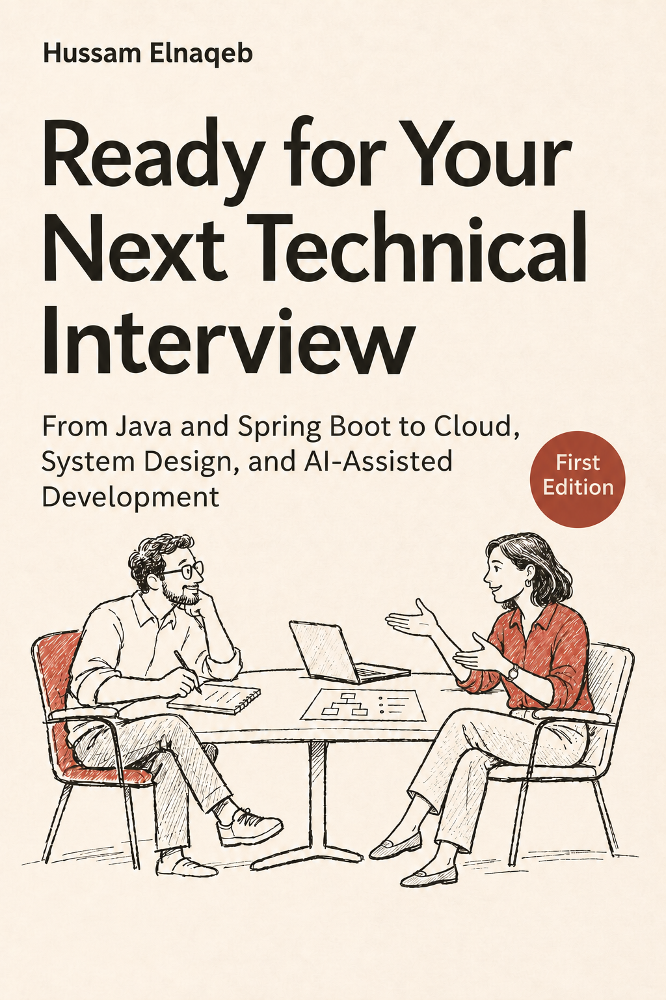

# Ready for Your Next Technical Interview

### From Java and Spring Boot to Cloud, System Design, and AI-Assisted Development

**By Hussam Elnaqeb · First Edition**

A practical preparation guide for **candidates and interviewers**, written in simple English, with examples, diagrams, and questions that connect technical concepts to real engineering decisions.

[**Read the ebook PDF**](./Ready_for_Your_Next_Technical_Interview.pdf) · [Read the Markdown version](./guide.md) · [Browse the interview questions](./questions.json)

## Why I wrote this guide

This ebook started as notes I took while preparing for technical interviews. I wanted one place to review the topics, understand how they connect, and practise explaining them clearly.

I organized those notes into this guide and decided to share it with others. My goal is to help candidates prepare with confidence and help interviewers ask useful questions and follow the reasoning behind an answer.

## What you will find

- **29 chapters** covering Java, Spring Boot, PostgreSQL, system design, cloud, and engineering practice.
- **200 interview questions**, with short model answers for most questions.
- **20 common coding challenges** with problem statements and examples. The ebook's coding challenge chapter has **no solutions or algorithm hints**, so you can practise independently.
- A **one-page cheat sheet after every chapter**.
- Clear diagrams, highlighted terms, and colored code in the PDF.
- Practical **AWS and GCP comparisons**.
- Examples of **AI-assisted development**, including verification, Playwright, MCP, and skills.
- Templates for **technical design documents**, **postmortems**, and **interview sessions**.

## Topics covered

| Area | Main topics |
| --- | --- |
| **Java foundations** | Strings, generics, exceptions, number types, collections, iterators, and streams |
| **Algorithms and coding** | Searching, sorting, complexity, and 20 coding practice problems |
| **SOLID and design patterns** | Responsibilities, dependency direction, composition, and practical pattern examples |
| **Spring Boot** | Dependency injection, bean scopes, profiles, configuration, APIs, and validation |
| **Persistence** | JPA, fetching, N+1, DTO projections, transactions, proxies, and rollback |
| **Concurrency and caching** | Shared state, atomic operations, parallel streams, cache keys, and invalidation |
| **Security and async work** | Authentication, authorization, tokens, tenant isolation, asynchronous work, and events |
| **Testing and PostgreSQL** | Unit and integration testing, execution plans, indexes, and query performance |
| **System design** | Requirements, capacity, data modeling, locking, replication, consistency, messaging, and resilience |
| **Practical workflows** | Orders, payments, inventory, notifications, idempotency, Saga, Outbox, and Inbox |
| **Cloud and operations** | Docker, Kubernetes, AWS, GCP, observability, deployment, migrations, and recovery |
| **AI and engineering practice** | RAG, agentic coding, Playwright, MCP, skills, design documents, postmortems, and leadership |

## How to use it

### If you are preparing for an interview

1. Start with the chapters related to the role.
2. Read the explanation and walk through the examples.
3. Answer the questions aloud before reading the model answers.
4. Solve the coding challenges yourself and explain your time and space complexity.
5. Use the chapter cheat sheets for a final review.
6. Prepare examples from your own work: a design decision, a difficult incident, and a tradeoff you made.

### If you are conducting an interview

1. Choose the topics and depth that match the role.
2. Use the questions to start a discussion, then ask follow-up questions.
3. Ask the candidate to explain assumptions, failure cases, and tradeoffs.
4. Assess reasoning and evidence, rather than expecting the exact wording in the guide.
5. Use the [interview session template](./interview_session_template.md) to keep the discussion consistent.

## Repository files

| File or folder | Purpose |
| --- | --- |
| [Ebook PDF](./Ready_for_Your_Next_Technical_Interview.pdf) | Formatted edition for reading and review |
| [guide.md](./guide.md) | Complete Markdown manuscript |
| [front.md](./front.md) and [body.md](./body.md) | Introduction, author information, and chapter source |
| [cheat_sheets.md](./cheat_sheets.md) | Chapter summaries in Markdown |
| [questions.json](./questions.json) | Numbered interview question bank |
| [figures/](./figures/) | Diagrams and editable visual assets |
| [examples/](./examples/) | AI development and testing examples |
| Java source files | Companion teaching examples |
| [references.json](./references.json) | Documentation and further reading |
| [Design document template](./design_document_template.md) | Structure for explaining a technical proposal |
| [Postmortem template](./postmortem_template.md) | Structure for recording an incident and follow-up actions |

## A note about the examples

The guide focuses on interview preparation. Code and configuration examples explain individual ideas; they are not a complete production application.

The reference baseline is **Java 21** and the **Spring Boot 3.5 / Spring Framework 6.2 / Spring Security 6** generation. Check the documentation for your project's versions before using a snippet.

AI can help you inspect code, explore alternatives, and draft tests. **You still own the result.** Review changes and verify behavior with appropriate checks. The Playwright example is illustrative and requires an application and test setup before it can run.

## About the author

**Hussam Elnaqeb** is a **PMP-certified engineering leader** with **12+ years of experience** in fintech, B2B commerce, and SaaS, including **5+ years leading engineering teams**.

He has managed teams of up to **21 engineers**, worked on products across four African markets, conducted **200+ interviews**, and made **30+ hires**. His experience includes Java, Spring Boot, PostgreSQL, distributed systems, architecture, hiring, and engineer development.

## Feedback and corrections

Found an unclear explanation, a technical mistake, or a broken example? [Open an issue](https://github.com/hussam7ussien/Ready-for-your-next-technical-interview-e-book/issues) and include the chapter or question number, the problem, and a suggested correction when possible.

If this guide helps you, consider giving the repository a **star** and sharing it with someone preparing for an interview.

---

**Copyright © 2026 Hussam Elnaqeb.**
