# Using this guide

Prepare to explain the core ideas, solve common code challenges, and discuss practical design decisions. Try each question before reading its model answer.

## For the candidate

Explain the idea in your own words, use a small example, then say what can fail. For coding, clarify the input and output, check edge cases, and state **time complexity** and **space complexity**.

For system design, start with requirements and numbers. Draw the flow, then discuss failures, correctness, and cost. Prepare one real design decision and one incident story.

## For the interviewer

Choose the required skills and expected level first. Ask follow-ups such as "What if this request runs twice?" Record the reasoning and any hints you gave. Use **interview_session_template.md** to keep notes.

| Evidence | What to look for |
|---|---|
| Understanding | A correct explanation and example |
| Practical judgment | Useful tradeoffs and failure handling |
| Coding | Correct approach and boundary checks |
| Communication | Clear assumptions and decisions |

## Choose the right depth

Spend more time on transactions, concurrency, SQL plans, caching, and design decisions. Learn supporting terms through short definitions. Use the companion files for long setup examples.

## Interview questions and answers

**Q1 How should a candidate prepare for an advanced technical interview?**

Review the core ideas, practise explaining a small example, and solve problems aloud. Prepare one design decision and one incident story from your own work.

**Q2 How should an interviewer choose questions?**

Choose the skills needed for the role first. Ask a small set of useful questions, follow the reasoning, and record what the candidate showed and where help was needed.

# Java essentials

An **array** has a fixed length. A **List** stores a sequence of values and provides methods such as add, get, and remove. A growable implementation such as **ArrayList** can change size.

| Value | How to read its size | Example |
|---|---|---|
| Array | length | nums.length |
| String | length() | name.length() |
| Collection | size() | names.size() |

## Arrays lists and boxing

**Boxing** converts an int to Integer. **Unboxing** converts it back. This is why an enhanced for loop can use int with a List of Integer. A null element fails during unboxing.

```java
int[] nums = {1, 2, 4};
List<Integer> numbers = new ArrayList<>();
for (int num : nums) {
    numbers.add(num);
}

List<Integer> copy = new ArrayList<>(List.of(1, 2, 4));
int[] result = new int[]{1, 2, 3};
```

**Arrays.asList(nums)** with an int[] creates a list containing that array, not a List of Integer. Use a loop or Arrays.stream(nums).boxed().

## Which list can you change

**Unmodifiable** means you cannot add, remove, or replace elements through that list. **Fixed-size** means you can replace elements, but cannot change their number.

| Operation | List.of | Arrays.asList |
|---|---|---|
| Add an element | Not allowed | Not allowed |
| Remove an element | Not allowed | Not allowed |
| Replace using set | Not allowed | Allowed |
| Store null elements | Not allowed | Allowed |

```java
List<String> fixed = Arrays.asList("Ali", "Mona");
fixed.set(0, "Omar"); // [Omar, Mona]
// fixed.add("Sara"); // UnsupportedOperationException

List<String> unmodifiable = List.of("Ali", "Mona");
// unmodifiable.set(0, "Omar"); // UnsupportedOperationException
// List.of("Ali", null);       // NullPointerException
```

**Backed by the array** means the list and the original reference array share the same element storage. A change through either one is visible through the other.

```java
String[] array = {"Ali", "Mona"};
List<String> names = Arrays.asList(array);
names.set(0, "Omar");
System.out.println(array[0]); // Omar
array[1] = "Sara";
System.out.println(names);    // [Omar, Sara]
```

For a list you can freely edit, create an **ArrayList**. This copies the element references into a separate list; it does not make deep copies of the objects.

```java
List<String> names = new ArrayList<>(List.of("Ali", "Mona"));
names.add("Sara");
names.remove("Ali");
names.set(0, "Omar");
System.out.println(names); // [Omar, Sara]
```

## Strings and equality

**String** is immutable. Methods such as concat return a result; they do not change the existing string.

```java
String text = "";
text.concat("a");        // text is still empty
text = text.concat("a");
int position = text.indexOf("a"); // 0

for (char letter : text.toCharArray()) {
    System.out.println(letter);
}
```

Use **equals** to compare String content. For object references, **==** checks whether both references point to the same object. Use **StringBuilder** when building text repeatedly in one thread.

```java
String first = new String("Ali");
String second = new String("Ali");
System.out.println(first == second);      // false: different objects
System.out.println(first.equals(second)); // true: same content

String missing = null;
System.out.println(Objects.equals(missing, "Ali")); // false
System.out.println(Objects.equals(null, null));     // true
```

Use **Objects.equals(a, b)** when either reference might be null. Calling missing.equals(...) would throw NullPointerException.

## Generic types and return values

**<T>** declares a generic type parameter. T is a placeholder for a reference type, such as String or Integer. The letter usually means Type; it is a name, not a special keyword.

```java
class Box<T> {
    private final T value;
    Box(T value) { this.value = value; }
    T get() { return value; }
}

Box<String> text = new Box<>("Hello");
String message = text.get(); // Hello
Box<Integer> number = new Box<>(10);
Integer result = number.get(); // 10
// Box<Integer> wrong = new Box<>("Hello"); // Compilation error
```

For Box<String>, get() returns String. For Box<Integer>, it returns Integer. Java checks the chosen types at compile time. Use wrapper types in generics: List<Integer> is valid; List<int> is not. The diamond <> lets the compiler infer the type arguments.

## Choosing a number type

**long** stores larger whole numbers than int. **BigDecimal** handles decimal arithmetic with controlled precision and rounding. Java has no standard numeric type named Decimal or just Big.

| Type | Stores | Common use |
|---|---|---|
| int or Integer | Signed 32-bit whole numbers | Quantities and small counters |
| long or Long | Signed 64-bit whole numbers | Large IDs and counters |
| BigInteger | Whole numbers beyond the long range | Very large calculations |
| BigDecimal | Arbitrary-precision decimal numbers | Prices and decimal calculations |

Integer and Long are object wrappers. Each has the same numeric range as its primitive, but can hold null and be used in generics. BigInteger and BigDecimal still need memory; arbitrary precision does not mean unlimited resources.

```java
int quantity = 10;
long productId = 3_000_000_000L; // Above int maximum: 2,147,483,647
System.out.println(0.1 + 0.2);  // 0.30000000000000004

BigDecimal first = new BigDecimal("0.1");
BigDecimal second = new BigDecimal("0.2");
System.out.println(first.add(second)); // 0.3
BigDecimal rounded = new BigDecimal("99.955")
    .setScale(2, RoundingMode.HALF_UP); // 99.96
```

Create BigDecimal from strings for the intended decimal value. new BigDecimal(0.1) preserves the double's approximation. BigDecimal is immutable: keep the returned result. Choose rounding from the business rule; some divisions need an explicit scale and rounding mode.

```java
updatePrice(3_000_000_000L, new BigDecimal("99.95"));
```

Here long is the ID type and BigDecimal is the price type. Choose the ID range from the database schema; a small ID can also fit in int.

## Checked and unchecked exceptions

An **exception** interrupts normal execution when something goes wrong. Checked and unchecked describe the compiler's rules, not whether the failure happens at runtime.

| Kind | Example | Compiler requirement |
|---|---|---|
| Checked exception | IOException | Catch it or declare it with throws |
| Unchecked exception | IllegalArgumentException | Catching or declaring is optional |

RuntimeException and its subclasses are unchecked. Error and its subclasses are also unchecked. Both kinds can still make a running operation fail.

**throw** raises an exception now. **throws** declares that a method may let that exception reach its caller. It does not throw anything by itself, handle the failure, or change the return type.

```java
public void readFile(String filePath) throws IOException {
    if (filePath == null || filePath.isEmpty()) {
        throw new IOException("File path cannot be empty.");
    }
    System.out.println("Reading file: " + filePath);
}
```

This teaching method validates the path and prints a message; it does not actually read a file. Its return type is void. On an empty path, throw stops normal execution, so the println is skipped.

The caller has two choices. **Catch** the checked exception and handle it:

```java
public void showFile() {
    try {
        readFile("");
        System.out.println("Finished"); // Skipped on this failure
    } catch (IOException ex) {
        System.out.println(ex.getMessage());
    }
}
```

Or **declare** the exception and let the next caller decide:

```java
public void forwardRequest() throws IOException {
    readFile("");
}
```

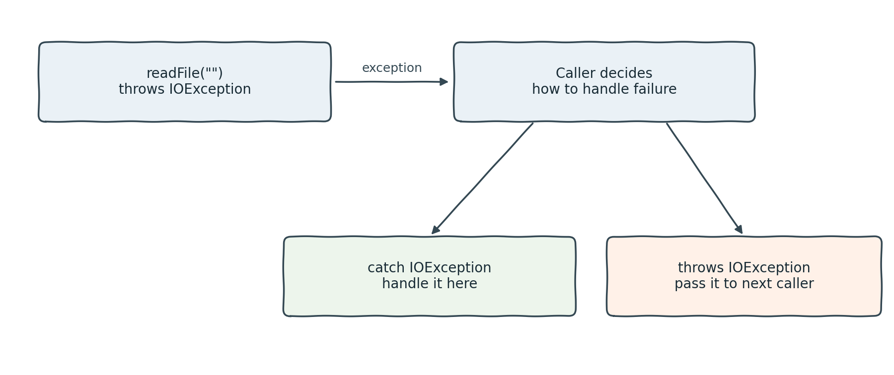

An unchecked example needs no throws declaration:

```java
public void checkQuantity(int quantity) {
    if (quantity < 0) {
        throw new IllegalArgumentException("Quantity cannot be negative");
    }
}
```

Callers can still catch it when they have a useful recovery action. Java's checked-exception rules are separate from Spring's transaction rollback rules, explained later.

Further reading [S151] [S152] [S153]

## AI usage hint

Ask AI for edge cases and expected results, then run small examples. Verify null behavior and numeric precision instead of trusting a plausible explanation.

## Interview questions and answers

**Q3 What is the difference between an array and a List?**

An array has a fixed length. A List offers collection operations and can grow when its implementation allows it. Arrays can store primitives; a List uses reference types such as Integer.

**Q4 Why does String concat seem to do nothing?**

String is immutable. concat returns a new result. Assign it back, such as text = text.concat("a"), if you want the variable to hold that result.

**Q5 Can an enhanced for loop use int with a List of Integer?**

Yes. Java unboxes each Integer into int. A null element causes NullPointerException during unboxing. Using Integer keeps the nullable reference.

**Q6 What is the difference between equals and double equals?**

For object references, == checks whether both refer to the same object. equals checks the type's defined equality. For String content, use equals.

**Q7 How do List of and Arrays asList differ?**

List.of returns an unmodifiable list and rejects null elements. Arrays.asList returns a fixed-size view backed by the array; set is allowed, but add and remove are not.

Further reading [S61] [S65] [S67]

# Collections

Choose the collection from the operation you need. Use a **List** for a sequence, a **Set** for uniqueness, and a **Map** for lookup by key.

## Interfaces and implementations

**List**, **Set**, and **Map** are interfaces in the **Java Collections Framework**. List and Set extend Collection. Map is a separate interface; it does not extend Collection.

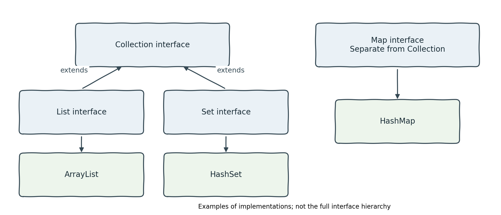

| Interface | What it stores | Duplicate rule | Implementation example |
|---|---|---|---|
| List | A sequence accessed by index | Values can repeat | ArrayList |
| Set | Unique elements | Equal elements cannot repeat | HashSet |
| Map | Key and value pairs | Keys are unique; values can repeat | HashMap |

```java
List<String> names = new ArrayList<>();
names.add("Ali");
names.add("Ali"); // [Ali, Ali]

Set<String> unique = new HashSet<>();
unique.add("Ali");
unique.add("Ali"); // Still one Ali

Map<Integer, String> users = new HashMap<>();
users.put(1, "Ali");
users.put(1, "Omar"); // {1=Omar}: same key, replacement value
```

In List<String> names = new ArrayList<>(), **List** is the interface used by the variable and **ArrayList** is the class that implements it. The variable's declared type determines which methods you can call; the object provides the implementation.

## Methods to remember

| List method | Meaning |
|---|---|
| add(value) | Append a value |
| add(index, value) | Insert and shift later values |
| get(index) | Read a value |
| set(index, value) | Replace a value |
| contains(value) | Check membership |
| remove(index) | Remove by position |
| remove(object) | Remove the first equal value |

The remove overload trap is covered in the questions below. List has no hasKey or hasValue method.

| Set method | Meaning |
|---|---|
| add(value) | Add it; false means it already exists |
| contains(value) | Check membership |
| remove(value) | Remove it if present |
| addAll(other) | Add the other set's values |
| retainAll(other) | Keep only shared values |

| Map method | Meaning |
|---|---|
| put(key, value) | Add or replace a mapping |
| putIfAbsent(key, value) | Add if the key is missing or its value is null |
| get(key) | Read the mapped value |
| getOrDefault(key, fallback) | Use a fallback for an absent key |
| containsKey(key) | Check for a key |
| containsValue(value) | Search the values |
| remove(key) | Remove the mapping |

**HashMap** and **HashSet** normally give fast average lookup. HashSet does not promise iteration order. Keep keys stable while they are stored.

## Stack queue and deque

Use **ArrayDeque** for a **stack** or a **FIFO queue**.

```java
Deque<Integer> stack = new ArrayDeque<>();
stack.push(10); stack.push(20);
Integer top = stack.peek();    // 20; stack stays [20, 10]
Integer removed = stack.pop(); // 20; stack becomes [10]
Integer next = stack.peek();   // 10; stack stays [10]
Queue<Integer> queue = new ArrayDeque<>();
queue.offer(10); queue.offer(20);
queue.peek(); // 10 without removing it
queue.poll(); // returns and removes 10
```

For Deque<Integer>, the element type is Integer. That is why peek() and pop() return Integer, while push() returns void.

| Method | Return type | Effect | Empty collection |
|---|---|---|---|
| push(value) | void | Add at the top | Adds normally |
| peek() | Integer | Read the top without removing it | Returns null |
| pop() | Integer | Remove and return the top | Throws NoSuchElementException |
| offer(value) | boolean | Queue insertion | Returns whether accepted |
| poll() | Integer | Remove and return the queue head | Returns null |

If you assign a null peek() result to int, unboxing throws NullPointerException. An Integer variable can hold that null result.

Queue peek and poll return null when empty. ArrayDeque rejects null. **LinkedList** also supports List and Deque; compare its cost in Q16.

## Iterator and ListIterator

An **Iterator** walks forward through a collection. **ListIterator** extends Iterator and adds list-specific operations, including moving backward. Modification methods work only when the underlying collection supports them.

| Operation | Iterator | ListIterator |
|---|---|---|
| Move forward | next() | next() |
| Move backward | Not available | previous() |
| Remove last returned element | remove() | remove() |
| Replace last returned element | Not available | set(value) |
| Insert at the cursor | Not available | add(value) |
| Available from | Lists and sets | Lists |

```java
List<Integer> numbers = new ArrayList<>(List.of(10, 20, 30));
Iterator<Integer> forward = numbers.iterator();
forward.next(); // 10
forward.next(); // 20

ListIterator<Integer> cursor = numbers.listIterator();
cursor.next();     // 10
cursor.next();     // 20
cursor.previous(); // 20
cursor.previous(); // 10
```

The cursor sits between elements. After two next() calls it is after 20. previous() crosses 20 again, returns it, and moves the cursor backward.

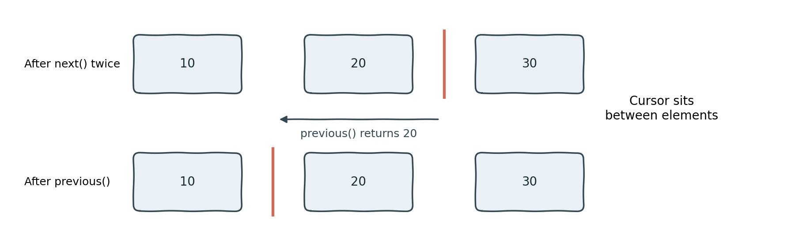

```java
ListIterator<Integer> edit = numbers.listIterator();
edit.next();  // Reads 10
edit.set(15); // [15, 20, 30]
edit.add(17); // [15, 17, 20, 30]
```

set() changes the last element returned by next() or previous(). add() inserts before the element that next() would return. Both return void. remove() also returns void.

Call next() or previous() before set() or remove(). remove() is allowed once per returned element. After add() or remove(), call next() or previous() before another set(); after add(), also advance before remove(). Use hasNext() and hasPrevious() to check boundaries; stepping beyond them throws NoSuchElementException. While iterating, use the iterator's supported mutation methods instead of changing the list structure directly.

**LinkedList** can insert or remove in constant time once its iterator is at the required position. Finding that position still takes time. ArrayList is usually a good default for indexed reads and iteration.

Further reading [S154]

## Interview questions and answers

**Q8 When should you use a List a Set or a Map?**

Use List for an ordered sequence, Set for unique values, and Map for lookup by a key. Choose based on the operation you need most.

**Q9 What does Set add return for a duplicate?**

It returns false when an equal value is already present. A newly added value returns true. This makes duplicate detection simple.

**Q10 How do HashMap put and putIfAbsent differ?**

put adds a mapping or replaces the existing value. putIfAbsent adds the value only if the key is missing or its current value is null. It keeps an existing value that is not null.

**Q11 How do containsKey and containsValue differ?**

containsKey looks for a key. containsValue searches stored values. In HashMap, key lookup is normally constant time on average; searching values is linear.

**Q12 What is a hash collision?**

Different keys can share a hash bucket. The map still checks equality to find the correct key. A collision does not mean the keys are equal.

**Q13 Why should a Map key be stable?**

Changing fields used by equals or hashCode after insertion can make lookup fail. Prefer immutable keys or fields that stay unchanged while the key is stored.

**Q14 What is the remove trap with a List of Integer?**

remove(1) removes the element at index 1. remove(Integer.valueOf(1)) removes the first value equal to 1. The argument type selects the overload.

**Q15 What is the difference between a stack and a queue?**

A stack is last in first out. A FIFO queue is first in first out. ArrayDeque can support both patterns; use the matching push/pop or offer/poll operations.

**Q16 When is LinkedList useful compared with ArrayList?**

LinkedList supports cheap changes at the ends or through an already positioned iterator. Indexed access is linear. ArrayList is usually a useful default for indexed access and iteration.

Further reading [S60] [S62] [S63] [S64]

# Streams

A **Stream** is a pipeline for reading and transforming data. **Intermediate operations** build the pipeline. A **terminal operation** produces the result. Create another stream if you need another traversal.

## Filter map distinct and sorted

```java
List<Integer> result = numbers.stream()
    .filter(n -> n % 2 == 0)
    .distinct()
    .sorted()
    .toList();

List<String> upperNames = names.stream()
    .filter(name -> name.startsWith("a") || name.startsWith("A"))
    .map(name -> name.toUpperCase(Locale.ROOT))
    .sorted()
    .toList();
```

**filter** selects values. **map** changes values. **distinct** removes duplicates. **sorted** orders the result. The name example assumes non-null strings; startsWith also handles an empty string.

## A reusable condition with Predicate

**Predicate<T>** accepts one value of type T and returns boolean. A lambda supplies the condition; test(value) runs it.

```java
Predicate<Integer> isEven = n -> n % 2 == 0;
isEven.test(4); // true
isEven.test(5); // false
List<Integer> numbers = List.of(1, 2, 3, 4, 5, 6);
List<Integer> even = numbers.stream().filter(isEven).toList();
// [2, 4, 6]
```

The same condition works in several operations:

```java
numbers.stream().anyMatch(isEven);  // true: at least one matches
numbers.stream().allMatch(isEven);  // false: not every value matches
numbers.stream().noneMatch(isEven); // false: some values match
List<Integer> values = new ArrayList<>(numbers);
values.removeIf(isEven); // Changes values to [1, 3, 5]
```

removeIf changes the original collection, so use a modifiable one. filter builds a stream result instead.

```java
Predicate<Integer> positive = n -> n > 0;
Predicate<Integer> positiveAndEven = positive.and(isEven);
positiveAndEven.test(4);  // true
positiveAndEven.test(-4); // false
Predicate<Integer> positiveOrEven = positive.or(isEven);
positiveOrEven.test(-4);  // true: even
positiveOrEven.test(3);   // true: positive
positiveOrEven.test(-3);  // false
Predicate<Integer> isOdd = isEven.negate();
isOdd.test(3); // true

Predicate<String> hasText = text -> text != null && !text.isBlank();
hasText.test("Hussam"); // true
hasText.test("   ");    // false
hasText.test(null);     // false
```

**Short-circuit evaluation** means && skips the right side when the left side is false. That avoids calling isBlank() on null. Predicate.and() and or() also short-circuit.

You can accept a predicate in your own generic method:

```java
static <T> List<T> filter(List<T> input, Predicate<T> condition) {
    List<T> result = new ArrayList<>();
    for (T item : input) {
        if (condition.test(item)) {
            result.add(item);
        }
    }
    return result;
}

List<Integer> result = filter(numbers, positiveAndEven);
// [2, 4, 6]
```

The <T> before List<T> declares this method's type parameter. The method assumes input and condition are not null. Import Predicate from java.util.function.

## Which terminal operation should you use

filter(), distinct(), and sorted() are **intermediate operations**. They describe the work. A **terminal operation** asks for a result or an action. Streams are lazy; do not depend on side effects in intermediate stages, because processing may stop early or stages may be optimized away.

| Terminal operation | Purpose | Return type for Stream<T> |
|---|---|---|
| toList() | Collect into a list | List<T> |
| collect(...) | Build a list, set, map, or other result | Depends on collector |
| forEach(...) | Perform an action for each element | void |
| forEachOrdered(...) | Perform actions in encounter order | void |
| count() | Count elements | long |
| anyMatch / allMatch / noneMatch | Test a condition | boolean |
| findFirst() | Find the first element in encounter order | Optional<T> |
| findAny() | Find any element | Optional<T> |
| min(...) / max(...) | Find an extreme using a comparator | Optional<T> |
| reduce(...) | Combine values | Value or Optional<T> |
| toArray(...) | Collect into an array | Object[] or chosen array type |

forEachOrdered preserves encounter order when one exists, including in a parallel stream. findAny does not promise a particular element.

```java
List<Integer> numbers = List.of(2, 4, 6);
long count = numbers.stream().count(); // 3
boolean hasEven = numbers.stream().anyMatch(n -> n % 2 == 0);
int first = numbers.stream().findFirst().orElse(-1); // 2
int total = numbers.stream().reduce(0, Integer::sum); // 12
```

**Optional<T>** represents a result that may be absent. findFirst() on an empty stream returns an empty Optional. orElse(-1) supplies a fallback; choose one that makes sense for your domain.

```java
int total = numbers.stream().mapToInt(Integer::intValue).sum();
double average = numbers.stream().mapToInt(Integer::intValue)
    .average().orElse(0.0); // 4.0
IntSummaryStatistics stats = numbers.stream()
    .mapToInt(Integer::intValue).summaryStatistics();
// stats.getCount() = 3; getSum() = 12; getMin() = 2; getMax() = 6
```

mapToInt creates an **IntStream**, a stream of primitive int values. sum() returns int, average() returns OptionalDouble, and summaryStatistics() returns IntSummaryStatistics. Every example starts a fresh stream: a stream cannot be reused after a terminal operation, but the same list can create another stream.

## toList and collectors

```java
List<Integer> result = numbers.stream().filter(n -> n % 2 == 0)
    .distinct().sorted().toList();
List<Integer> collected = numbers.stream()
    .collect(Collectors.toList());
List<Integer> editable = numbers.stream()
    .collect(Collectors.toCollection(ArrayList::new));
```

**Stream.toList()** returns an unmodifiable list. **Collectors.toList()** does not promise a particular implementation or mutability. Use toCollection(ArrayList::new) when you need a modifiable ArrayList. The syntax is collect(Collectors.toList()), not .Collectors.toList().

## Why Locale ROOT appears in the name example

**Locale.ROOT is optional.** toUpperCase() uses the application's default language and regional settings. toUpperCase(Locale.ROOT) uses language-neutral rules so the server's default locale does not change the conversion.

```java
"ali".toUpperCase(Locale.ROOT);                 // ALI
"ali".toUpperCase(Locale.forLanguageTag("tr")); // ALİ (dotted capital I)
```

Keep Locale.ROOT for language-neutral conversion. Pass the user's locale when the result should follow that user's language. Use the no-argument version when the application's default locale is the intended rule. Locale.ROOT does not transliterate names or make every language share the same casing rules.

Further reading [S155] [S156] [S157] [S158]

## Reduce and flatMap

```java
int total = List.of(2, 3, 4).stream()
    .reduce(0, Integer::sum); // 9

int product = List.of(2, 3, 4).stream()
    .reduce(1, (a, b) -> a * b); // 24

List<Integer> flat = List.of(List.of(1, 2), List.of(3, 4))
    .stream()
    .flatMap(List::stream)
    .toList(); // [1, 2, 3, 4]
```

The **identity** is zero for addition and one for multiplication. **flatMap** joins the inner streams into one sequence. Use **mapToInt** when you want primitive operations such as sum or average.

**Stream.toList** is unmodifiable. For a mutable ArrayList, use collect(Collectors.toCollection(ArrayList::new)). Keep required business side effects out of **peek**. The Stream can skip work it proves unnecessary.

## Interview questions and answers

**Q17 How do filter and map differ?**

filter keeps matching elements. map changes each element into a result. For example, filter active users, then map each user to an email address.

**Q18 How do you remove duplicates in a Stream?**

Use distinct. It uses element equality. reduce combines values into one result; it is not the usual duplicate-removal operation.

**Q19 When do Stream operations execute?**

Intermediate operations are lazy. A terminal operation such as toList or sum drives the pipeline. Required business side effects should not depend on peek running.

**Q20 What is the identity value in reduce?**

It is a starting value that leaves the operation unchanged: zero for addition and one for multiplication. Parallel reduction also needs a suitable associative operation.

**Q21 How do map and flatMap differ?**

map produces one result per input. flatMap produces and joins streams from each input. Use it to turn a list of lists into one sequence of elements.

**Q22 Does Stream toList return a mutable ArrayList?**

No. Stream.toList returns an unmodifiable list. Use Collectors.toCollection(ArrayList::new) when the result must be a mutable ArrayList.

**Q23 Why can a parallel Stream be slower?**

Splitting, coordination, and merging have a cost. Small inputs, cheap work, blocking calls, and contention can remove the expected benefit. Measure the actual workload.

Further reading [S24] [S66]

# Searching and sorting

**Searching** finds a value. **Sorting** puts values in order so later work becomes easier. Ask whether the input is already sorted, whether you may change it, and whether the order will be reused.

## Searching

**Linear search** checks each item. It works on unsorted input and takes O(n) time. **Binary search** removes half the remaining range each step and takes O(log n) time on sorted input.

```java
static int binarySearch(int[] values, int target) {
    int left = 0, right = values.length - 1;
    while (left <= right) {
        int mid = left + (right - left) / 2;
        if (values[mid] == target) return mid;
        if (values[mid] < target) left = mid + 1;
        else right = mid - 1;
    }
    return -1;
}
```

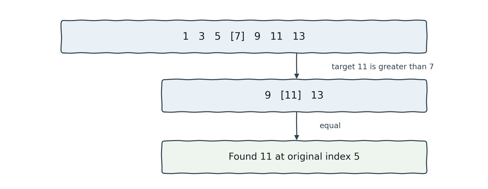

Write down whether your bounds include their endpoints. Each branch must make progress. A first-occurrence question needs a suitable variation, such as **lower bound**, instead of returning any match.

## Sorting comparison

The bounds below describe the teaching implementations in **Algorithms.java**. Extra space excludes the input array.

| Algorithm | Typical time | Worst time | Extra space | Stable |
|---|---|---|---|---|
| Bubble with early exit | O(n²) | O(n²) | O(1) | Yes |
| Selection | O(n²) | O(n²) | O(1) | No |
| Insertion | O(n²) | O(n²) | O(1) | Yes |
| Merge | O(n log n) | O(n log n) | O(n) | Yes |
| Randomized quick | Expected O(n log n) | O(n²) | Expected O(log n) stack | No |
| Heap with iterative sift | O(n log n) | O(n log n) | O(1) | No |

**Bubble sort** swaps neighboring values. **Selection sort** repeatedly selects the smallest remaining value. **Insertion sort** inserts each value into a sorted prefix and works well on small or nearly sorted input.

**Merge sort** splits the input and merges sorted parts. It gives predictable time and stable order, but needs a buffer. Its O(n) extra-space bound includes its smaller recursion stack.

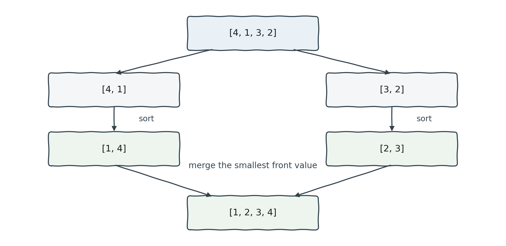

**Quick sort** partitions around a pivot. It often works well on arrays, but poor partitions can cause quadratic time and linear stack space. The simple two-way version also performs poorly on many equal values.

**Heap sort** repeatedly removes the largest value from a max heap. It has a worst-case O(n log n) bound and little extra memory, but is not stable.

In normal application code, prefer a suitable standard library sort. For interview practice, the companion file contains all six full implementations, linear search, binary search, and lower bound.

## Interview questions and answers

**Q24 When is linear search better than sorting first?**

For one search in a small unsorted array, a linear scan is often enough. Sorting first adds work. Sorting becomes more useful when many later operations reuse the order.

**Q25 What does binary search require?**

A sorted array or another search space with a monotonic condition. Each step must safely remove part of the remaining range and make progress.

**Q26 What do time complexity and space complexity mean?**

Time complexity describes how work grows with input size. Space complexity describes memory growth. State whether the memory count includes output, temporary arrays, and the recursion stack.

**Q27 What does stable sorting mean?**

Equal sort keys keep their original relative order. This matters when sorting records by several fields or preserving an earlier ordering.

**Q28 How would you choose between merge quick and heap sort?**

Merge sort gives stable order with a temporary buffer. Quick sort often performs well on arrays but needs careful partitioning. Heap sort gives a worst-case O(n log n) bound with little extra memory.

**Q29 Does quick sort always use constant extra memory?**

No. Recursive quick sort also uses stack memory. The simple version can use O(n) stack space in its worst case, even though partitioning uses little local memory.

Further reading [S113] [S114]

# Coding challenges

These **20 common interview problems** are for independent practice. Each includes a problem statement and an input and output example. This chapter contains **no solutions or algorithm hints**.

## 1. Two Sum

Given an integer array and a target, return the indices of two distinct elements whose sum equals the target. Assume exactly one valid pair.

**Input:** `nums = [2, 7, 11, 15], target = 9`

**Output:** `[0, 1]`

## 2. Contains Duplicate

Return true if any value appears more than once in an integer array.

**Input:** `[1, 2, 3, 1]`

**Output:** `true`

## 3. Valid Anagram

Given two lowercase English strings, return true if they contain the same letters with the same counts.

**Input:** `s = "anagram", t = "nagaram"`

**Output:** `true`

## 4. Valid Palindrome

Return true if a string reads the same in both directions after ignoring characters that are not letters or digits and ignoring letter case.

**Input:** `"A man, a plan, a canal: Panama"`

**Output:** `true`

## 5. Valid Parentheses

A string contains only (), [], and {}. Return true if every opening bracket is closed in the correct order.

**Input:** `"([]){}"`

**Output:** `true`

## 6. Merge Two Sorted Lists

Merge two sorted singly linked lists and return the head of one sorted list.

**Input:** `[1, 2, 4] and [1, 3, 4]`

**Output:** `[1, 1, 2, 3, 4, 4]`

## 7. Reverse Linked List

Reverse a singly linked list and return its new head.

**Input:** `[1, 2, 3]`

**Output:** `[3, 2, 1]`

## 8. Linked List Cycle

Return true if following next pointers in a linked list can revisit the same node.

**Input:** `1 -> 2 -> 3, with node 3 pointing back to node 2`

**Output:** `true`

## 9. Binary Search

Given a sorted integer array with distinct values, return the index of a target or -1 if it is missing.

**Input:** `nums = [-1, 0, 3, 5, 9, 12], target = 9`

**Output:** `4`

## 10. Best Time to Buy and Sell Stock

Each array element is a daily stock price. Find the maximum profit from one purchase followed by one sale on a later day. Return 0 if no profit is possible.

**Input:** `[7, 1, 5, 3, 6, 4]`

**Output:** `5`

## 11. Maximum Subarray

Find the largest sum of a nonempty contiguous subarray.

**Input:** `[-2, 1, -3, 4, -1, 2, 1, -5, 4]`

**Output:** `6`

## 12. Move Zeroes

Move all zeroes to the end of an array in place while keeping the relative order of other values.

**Input:** `[0, 1, 0, 3, 12]`

**Output:** `[1, 3, 12, 0, 0]`

## 13. Product of Array Except Self

For each position, return the product of all other elements. Do not use division. Assume all required products fit the chosen numeric type.

**Input:** `[1, 2, 3, 4]`

**Output:** `[24, 12, 8, 6]`

## 14. Longest Substring Without Repeating Characters

Return the length of the longest contiguous substring containing no repeated characters.

**Input:** `"abcabcbb"`

**Output:** `3`

## 15. Group Anagrams

Group lowercase English strings that contain the same letters with the same counts. Group order does not matter.

**Input:** `["eat", "tea", "tan", "ate", "nat", "bat"]`

**Output:** `[["eat", "tea", "ate"], ["tan", "nat"], ["bat"]]`

## 16. Merge Intervals

Given closed intervals, merge all intervals that overlap. Intervals sharing an endpoint overlap.

**Input:** `[[1, 3], [2, 6], [8, 10], [15, 18]]`

**Output:** `[[1, 6], [8, 10], [15, 18]]`

## 17. Kth Largest Element in an Array

Return the kth largest element, counting duplicates as separate positions. Assume k is valid.

**Input:** `nums = [3, 2, 1, 5, 6, 4], k = 2`

**Output:** `5`

## 18. Maximum Depth of Binary Tree

Return the number of nodes on the longest root-to-leaf path. An empty tree has depth 0.

**Input:** `root 1 has children 2 and 3; node 2 has child 4`

**Output:** `3`

## 19. Number of Islands

Count groups of land cells in a rectangular grid. Land is 1, water is 0, and only horizontal or vertical neighbors connect.

**Input:** `[[1, 1, 0], [0, 1, 0], [0, 0, 1]]`

**Output:** `2`

## 20. Climbing Stairs

Given n steps, count the distinct ways to reach the top if each move climbs one or two steps. Assume n is positive and the result fits the chosen numeric type.

**Input:** `n = 3`

**Output:** `3`

## Interview discussion questions

**Q30 What information would you clarify before writing code?**

**Q31 How would you explain the correctness of your solution?**

**Q32 Which cases would you test before finishing?**

# SOLID and design patterns

**SOLID** helps you decide where code belongs and how parts should depend on each other. **Design patterns** describe useful ways to solve recurring design problems. Start with a real change or problem, then choose a design that makes the code easier to change and test.

## SOLID in practical terms

**Single Responsibility Principle or SRP:** keep together code that changes for the same business reason. Pricing rules, SQL storage, and email formatting usually change for different reasons. Put them behind clear boundaries. An OrderService can still coordinate the workflow. SRP does not mean one method per class.

**Open Closed Principle or OCP:** allow a known kind of change through an extension point. If shipping prices vary, a ShippingCost contract lets a new policy work with existing checkout code. You still change code to fix bugs or introduce a new requirement. Do not create an extension point for every imagined future feature.

**Liskov Substitution Principle or LSP:** an implementation must keep the behavior promised by its contract. If a repository promises that save works for valid input, a read-only implementation that always rejects save breaks that promise. Use a read-only contract instead. Check allowed inputs, results, state changes, and documented failures.

**Interface Segregation Principle or ISP:** let clients depend on the capabilities they need. A reporting service may only need OrderReader. It should not have to depend on order deletion and payment methods too. One class can implement several focused interfaces.

**Dependency Inversion Principle or DIP:** business policy should depend on a suitable abstraction, and infrastructure should implement that abstraction. Checkout can use a PaymentGateway contract while a provider adapter handles HTTP details. The business code then avoids depending on the provider's client library.

**Dependency injection or DI** is how an object receives a dependency. **DIP** is about the direction of source-code dependencies. Injecting a concrete provider client is DI, but the business code still depends on that concrete detail.

## Strategy with a shipping example

**Strategy** lets an object use one of several behaviors through the same contract. Here, the checkout calculation receives a shipping policy. Amounts are integer cents so the example avoids floating-point money.

```java
interface ShippingCost {
    int fee(int subtotalCents);
}

static final class Checkout {
    private final ShippingCost shipping;
    Checkout(ShippingCost shipping) {
        this.shipping = Objects.requireNonNull(shipping);
    }
    int total(int subtotalCents) {
        if (subtotalCents < 0) {
            throw new IllegalArgumentException("Negative subtotal");
        }
        int fee = shipping.fee(subtotalCents);
        if (fee < 0) throw new IllegalArgumentException("Negative fee");
        return Math.addExact(subtotalCents, fee);
    }
}
```

Choose the behavior when creating the checkout:

```java
Checkout pickup = new Checkout(subtotal -> 0);
Checkout delivery = new Checkout(subtotal -> 500);
System.out.println(pickup.total(2000));   // 2000 cents
System.out.println(delivery.total(2000)); // 2500 cents
```

Both policies accept a nonnegative subtotal and return a nonnegative fee. That shared contract matters for **LSP**. Adding another policy leaves Checkout unchanged, which illustrates **OCP**. Receiving ShippingCost also separates Checkout from concrete policies, which supports **DIP**.

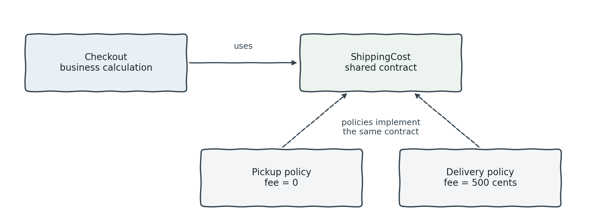

Prefer **composition** when you want to replace behavior: an object holds a collaborator and delegates work to it. Use inheritance when the subtype really keeps the parent contract.

## Patterns for creating objects

| Pattern | Main use | Small example |
|---|---|---|
| Simple Factory | Centralize an object choice in one method | Choose an exporter from a format value |
| Factory Method | Let a subclass decide which product to create | A creator supplies a shipping policy |
| Abstract Factory | Create a compatible family of related products | One factory creates a screen and printer for the same POS platform |
| Builder | Construct an object with clear optional steps | Build a report with optional charts |
| Singleton | Provide one instance within a defined scope | One process-level shared configuration object |

A **Simple Factory** and **Factory Method** are different ideas. This Factory Method example lets the subclass choose the shipping object:

```java
static abstract class CheckoutCreator {
    protected abstract ShippingCost createShipping();

    Checkout createCheckout() {
        return new Checkout(createShipping());
    }
}

static final class PickupCheckoutCreator extends CheckoutCreator {
    @Override
    protected ShippingCost createShipping() {
        return subtotal -> 0;
    }
}
```

A **Builder** can make optional settings easier to read:

```java
Report report = new Report.Builder("Daily sales")
        .withCharts()
        .build();
```

The companion file includes the builder and validates the required title. Builders are useful when construction has several options. A normal constructor is clearer for a small object with two obvious required values.

A **Spring singleton** means one instance per bean definition per container. It does not guarantee one instance across all application replicas or make mutable fields thread safe. For ordinary Spring services, let the container manage scope instead of adding a static getInstance method.

## Patterns for integrating and wrapping objects

**Adapter** translates between interfaces. Suppose the application expects send(email, text), but an older client uses deliver(body, recipient). The adapter keeps that translation in one place:

```java
record MailAdapter(OldMailClient client) implements ReceiptSender {
    MailAdapter {
        Objects.requireNonNull(client);
    }
    @Override
    public void send(String email, String text) {
        client.deliver(text, email);
    }
}
```

**Decorator** adds behavior around an object with the same contract. This wrapper records when a send starts and when it returns successfully:

```java
record LoggedSender(ReceiptSender next, List<String> log)
        implements ReceiptSender {
    LoggedSender {
        Objects.requireNonNull(next);
        Objects.requireNonNull(log);
    }
    @Override
    public void send(String email, String text) {
        log.add("Sending");
        next.send(email, text);
        log.add("Sent");
    }
}
```

ReceiptSender, the local fake mail client, imports, and runnable checks are in **DesignPatternsExamples.java**. The examples do not send real email.

**Proxy** provides a substitute that controls access or the call boundary. A Spring transaction proxy runs transaction handling around a target method. **Decorator** and **Proxy** can look similar in code; explain their purpose. A logging wrapper does not become a transaction proxy just because it delegates.

**Facade** gives a simpler entry point to several components. For example, a CheckoutFacade coordinates stock, payment, and order services. A facade still needs correct transaction and failure handling.

| Similar ideas | Useful distinction |
|---|---|
| Adapter and Facade | Adapter translates an interface; Facade simplifies access to a subsystem |
| Decorator and Proxy | Decorator adds behavior; Proxy controls access or invocation |
| Strategy and State | Strategy selects a behavior; State changes behavior with the object's current state |
| Observer and a durable queue | Observer notifies listeners; durability requires a separate delivery design |

## Other patterns to recognize

**Observer** notifies registered listeners about an event. Spring application events are a useful example. An in-memory listener alone does not guarantee recovery after a crash.

**State** moves state-specific behavior into state objects. An order may allow cancellation while pending and reject it after delivery. A simple enum and checked transitions can be enough; use state objects when the behavior justifies them.

**Template Method** defines a workflow in a base class and lets subclasses fill in selected steps. Strategy uses a separate collaborator and is often easier to swap at runtime.

Recognize these names without memorizing full implementations:

| Pattern | Short idea | Example |
|---|---|---|
| Bridge | Separate an abstraction from an implementation that varies independently | Report type and output device |
| Composite | Treat a leaf and a group through the same contract | A menu item and a nested menu group |
| Flyweight | Share reusable state instead of copying it into many objects | Shared font data for many characters |
| Prototype | Create an object by copying another object | Copy a configured report template |

The **Prototype pattern** is about copying. **Spring prototype scope** is about asking the container for a new bean instance. They are different concepts.

## Explain a pattern in an interview

Name the problem first. Show the roles with a small example, explain what changes without touching the caller, then discuss the extra classes or configuration it adds. A small switch can be clearer than several classes when the choice is small and stable.

For interviewers, ask what should happen when a second payment provider is added or an existing implementation rejects valid input. Judge the proposed contract and behavior, as well as the pattern name.

## Interview questions and answers

**Q33 What does Single Responsibility mean in practical code?**

Keep code with the same reason for change together. Separate concerns such as pricing policy, persistence, and email formatting when they change independently. A service can coordinate several collaborators while keeping one clear business purpose.

**Q34 Does Open Closed mean you must never edit an existing class?**

No. Create an extension point for a useful, known kind of change. A new shipping policy can implement the existing contract without changing Checkout. Bug fixes and new requirements can still require edits.

**Q35 How can an implementation violate Liskov Substitution?**

It breaks behavior promised by the shared contract, such as rejecting inputs the contract accepts or failing to provide a promised result. A read-only repository should not claim a save capability that it cannot provide. Judge the documented contract, not the class name.

**Q36 When is Interface Segregation useful?**

When clients depend on a large interface but need only a small part. Split capabilities around client needs, such as OrderReader and OrderWriter. One implementation can still provide both interfaces.

**Q37 What does Dependency Inversion change?**

Business policy depends on a contract such as PaymentGateway. The provider adapter implements that contract and keeps provider-specific HTTP code outside the policy.

**Q38 How do dependency injection and dependency inversion differ?**

DI supplies dependencies from outside an object. DIP directs code dependencies toward abstractions. Injecting a concrete provider client uses DI but can still couple business code to that provider.

**Q39 When would you use Strategy?**

Use it for interchangeable behaviors such as shipping policies. The caller delegates through one contract, and every policy must keep the same input and output expectations.

**Q40 How do Simple Factory Factory Method and Abstract Factory differ?**

Simple Factory centralizes a creation choice. Factory Method lets subclasses choose a product. Abstract Factory creates a compatible family of products. Explain which creation decision varies.

**Q41 When is Builder useful?**

Use it for several optional settings or clear construction steps. Validate required values. A constructor is often simpler for a small object with few options.

**Q42 How do Adapter and Facade differ?**

Adapter translates between interfaces, such as wrapping an older mail client. Facade provides a simpler entry point to several components, such as a checkout workflow.

**Q43 How do Decorator and Proxy differ?**

Decorator adds behavior around a collaborator with the same contract. Proxy controls access or invocation, as with Spring transaction interception. Their structures can look similar; explain their intent.

**Q44 How do Strategy and State differ?**

Strategy supplies a selected behavior. State changes behavior according to the object's current state and its transitions. A small state machine may only need an enum and explicit checks.

**Q45 Does Observer guarantee that an event survives an application crash?**

No. Observer describes listener notification. In-memory events can disappear after a crash. Persist the intent and use suitable durable delivery when recovery is required.

**Q46 Is a Spring singleton one instance across every app replica?**

No. Spring singleton scope is per bean definition per container. Different application processes can have different instances. Shared mutable state still needs safe coordination.

**Q47 When should you avoid adding a design pattern?**

Avoid it when extra classes and interfaces solve no real problem. Introduce a pattern when it makes an actual variation, contract, or responsibility easier to manage.

Further reading [S144] [S145] [S146] [S147] [S148] [S149] [S150]

# Spring Boot and dependency injection

**Spring** manages objects and their dependencies. **Spring Boot** makes application setup easier through starters, auto-configuration, and useful defaults. **SpringBootApplication** enables configuration, auto-configuration, and component scanning.

## Beans and injection

A **bean** is an object managed by Spring. Use **constructor injection** to make required dependencies clear.

```java
interface PriceProvider { BigDecimal price(long id); }
@Service("regular")
class RegularPrices implements PriceProvider {
    public BigDecimal price(long id) { return new BigDecimal("100.00"); }
}
@Service("premium")
class PremiumPrices implements PriceProvider {
    public BigDecimal price(long id) { return new BigDecimal("80.00"); }
}
@Service
class CheckoutService {
    private final PriceProvider prices;
    CheckoutService(@Qualifier("premium") PriceProvider prices) {
        this.prices = prices;
    }
}
```

**Qualifier** selects the premium implementation here. **Primary** instead marks the preferred default candidate.

## Service or Configuration and Bean

Both approaches register objects as **Spring beans**. They differ in how you tell Spring to create those objects.

| Approach | How the object is created | Common use |
|---|---|---|
| @Service on a class | Component scanning discovers it; Spring calls its constructor | Your business services |
| @Bean in @Configuration | Spring calls your factory method and manages its result | Library objects and custom setup |

In the pricing example, @Service("premium") registers PremiumPrices with the bean name premium. @Qualifier("premium") selects that candidate for CheckoutService, so price(id) returns 80.00.

For an alternative registration, remove @Service from RegularPrices and PremiumPrices and keep them as ordinary Java classes. Then register them here:

```java
@Configuration
class PricingConfig {
    @Bean("regular")
    PriceProvider regularPrices() {
        return new RegularPrices();
    }
    @Bean("premium")
    PriceProvider premiumPrices() {
        return new PremiumPrices();
    }
}
```

CheckoutService keeps the same constructor and receives PremiumPrices in both versions. @Configuration supplies bean definitions. @Bean registers its return value; the method name is the default bean name.

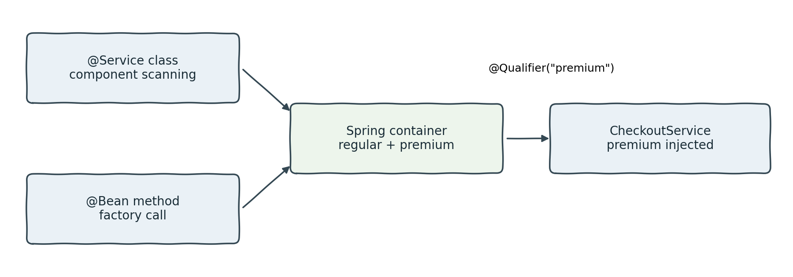

**Registration** makes a bean available; **selection** chooses which one to inject. Spring manages the object returned by @Bean, including its lifecycle, even when the method uses new. Calling new elsewhere does not automatically register a bean.

Use one registration route per intended bean to avoid name conflicts or unwanted candidates. Both routes support injection and default to one singleton instance per bean definition per Spring container.

Further reading [S159]

## Bean scope and initialization

| Scope | What to remember |
|---|---|
| Singleton | One instance per bean definition per container |
| Prototype | A new instance when the container is asked for one |
| Request | One instance for a web request |
| Session | One instance for a web session |

A prototype injected into a singleton is normally resolved once. **ObjectProvider** can request a new instance per operation. Scope does not provide thread safety.

Use **PostConstruct** for local initialization and **PreDestroy** for managed cleanup. They do not guarantee recovery after a crash.

## Profiles and configuration

A **profile** is a name used to select settings or beans, such as dev or prod. You decide which profiles are active when starting the application. Their names have no special priority.

Assume these files are all in src/main/resources:

| File | Setting | Purpose |
|---|---|---|
| application.properties | server.port=8080 | Shared default |
| application-dev.properties | server.port=8081 | Override for dev |
| application-prod.properties | server.port=9090 | Override for prod |

```bash
java -jar app.jar --spring.profiles.active=dev,prod
```

Both profiles are active. The base file supplies 8080, dev changes it to 8081, and prod changes it to 9090. **The final port is 9090 because prod is last.** Other base settings still apply unless overridden.

| Active profiles | Final port in this example |
|---|---|
| None | 8080 |
| dev | 8081 |
| prod | 9090 |
| dev,prod | 9090 |
| prod,dev | 8081 |

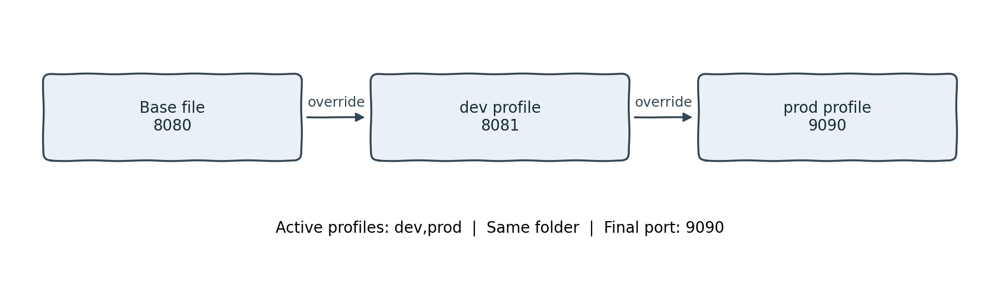

This last-wins rule applies within the same configuration location group. A location group contains locations treated at the same level. For this example, keep all three files in one folder; more complex location rules belong in the reference documentation.

## Property source priority

For these common sources, the order below is **highest priority first**. This is a practical subset of Spring Boot's full order; tests and other specialized sources can add more rules.

| Priority | Source | Example |
|---|---|---|
| 1 | Command-line argument | --server.port=7000 |
| 2 | JVM system property | -Dserver.port=7001 |
| 3 | Environment variable | SERVER_PORT=7002 |
| 4 | Configuration data | application.properties and imports |

```bash
SERVER_PORT=7002 java -Dserver.port=7001 -jar app.jar \
    --spring.profiles.active=dev,prod --server.port=7000
```

The port is 7000. Without --server.port, it is 7001. Without both overrides, it is 7002. Without all three, the profile files in our example give 9090. An environment variable overrides the files, but it does not override the JVM property in this setup.

Profile property precedence does not choose between beans. If two beans use @Profile("dev") and @Profile("prod"), activating both can enable both. Use @Qualifier or @Primary when injection needs one candidate.

Singleton beans normally initialize eagerly at application startup. That is about creating Spring objects, not fetching JPA relationships. Use **ConfigurationProperties** to group and validate related settings.

## Secrets Manager and configuration

**AWS Secrets Manager** stores sensitive values such as passwords and API keys. Values are encrypted using KMS, and access requires permissions. How the secret reaches the application determines its Spring property priority.

| Loading method | How Spring treats it |
|---|---|
| spring.config.import with Spring Cloud AWS | Imported configuration data |
| ECS injects an environment variable | An ordinary environment variable |
| Your code calls the AWS SDK | A value in your code; not automatically a Spring property |

Suppose /ordering/prod/database contains this JSON secret:

```json
{
  "spring.datasource.username": "app_user",
  "spring.datasource.password": "<stored-password>"
}
```

With a compatible Spring Cloud AWS BOM and the spring-cloud-aws-starter-secrets-manager dependency, put this in application-prod.properties:

```properties
spring.config.import=aws-secretsmanager:/ordering/prod/database
```

At startup with prod active, the integration reads the secret using authorized AWS credentials. Its top-level JSON keys become Spring properties and configure the database credentials.

In this setup, the import overrides matching values in the file importing it. Environment variables can override the imported values, and JVM properties and command-line arguments have higher priority. For example, SPRING_DATASOURCE_PASSWORD overrides the imported password. Other configuration locations can add precedence rules; a secret does not have a universal highest priority.

**Rotation needs a reload plan.** An ECS task does not automatically receive a changed secret injected into its environment; start a new task. Spring Cloud AWS supports configurable reload, but consumers such as an existing connection pool must also receive and use the updated credentials. Keep secrets out of source code and logs.

Further reading [S160] [S161] [S162]

## AI usage hint

Ask AI to trace the actual bean registrations and effective configuration sources. Check project versions and startup evidence before accepting an annotation change.

## Interview questions and answers

**Q48 What does Spring Boot add to Spring?**

It helps configure and start Spring applications through auto-configuration, starters, and useful defaults. It reduces setup work; the application still needs clear design and correct configuration.

**Q49 What does SpringBootApplication include?**

It combines configuration, auto-configuration, and component scanning. Keep the main class in an appropriate root package so scanning finds the intended components.

**Q50 Why prefer constructor injection?**

Required dependencies are visible when the object is created. It supports final fields and makes plain unit tests easier to write.

**Q51 How do Primary and Qualifier differ?**

Primary marks a preferred candidate for a single dependency. Qualifier narrows the candidates at an injection point. Use meaningful qualifiers when the choice is part of the design.

**Q52 Is a singleton bean automatically thread safe?**

No. Singleton describes scope. Several requests can use the same instance at once, so shared mutable fields need safe coordination.

**Q53 Why is one prototype injected into a singleton reused?**

Injection normally happens once when the singleton is created. Use ObjectProvider or another suitable lookup when a new prototype is needed for each operation.

**Q54 Does a production profile always override a development profile?**

Profile names have no built-in ranking. For conflicting values in the same location group, later active profiles win. Property-source priority also matters.

**Q55 Can an environment variable override application properties?**

Yes. Among common sources, command-line arguments rank above JVM system properties, then environment variables, then configuration data. An environment variable can override application.properties, but not a conflicting JVM system property in this setup.

**Q56 When should you use ConfigurationProperties?**

Use it to group related settings into a typed object. It makes validation and configuration clearer than many separate Value expressions.

**Q57 What can a circular dependency suggest?**

Responsibilities may be mixed between services. A coordinator or a clearer service boundary can remove the cycle. Delaying bean creation does not fix the design itself.

Further reading [S01] [S04] [S06] [S07]

# HTTP APIs and validation

Keep the **controller** focused on HTTP input and output. Put business decisions in the service. Use database constraints for rules that must hold across all writers.

```java
public record CreateOrderRequest(
    @NotNull Long customerId,
    @NotEmpty List<@Valid OrderLineRequest> lines) {}

public record OrderLineRequest(
    @NotNull Long productId,
    @Min(1) int quantity) {}

@PostMapping("/orders")
ResponseEntity<OrderDto> create(
        @Valid @RequestBody CreateOrderRequest request) {
    OrderDto result = orders.create(request);
    return ResponseEntity.created(
        URI.create("/orders/" + result.id())).body(result);
}
```

The example assumes the surrounding controller and service. **Valid** activates the configured validation. It does not prove stock availability or resource ownership.

## Responses and errors

Use **RestControllerAdvice** and suitable exception handlers to return consistent errors. Add a stable error code and a trace ID. Keep internal details out of public error messages.

| Status | Common API meaning |
|---|---|
| 200 or 204 | Successful operation |
| 201 | Resource created |
| 202 | Work accepted and still pending |
| 400 | Invalid request |
| 401 or 403 | Missing authentication or denied access |
| 404 or 409 | Missing resource or a state conflict |
| 429 or 500 | Rate limit or an unexpected server failure |

For a pending operation, return an identifier or URL the client can use to check progress. For lists, return bounded pages with stable ordering. **Cursor pagination** is useful when large offsets become costly.

## Interview questions and answers

**Q58 Where should validation happen?**

Validate request shape at the API boundary, then enforce business rules in the service and database. Valid syntax does not prove ownership, stock availability, or permission.

**Q59 What does Valid do on a request body?**

It triggers the configured validation for that input. Add constraints such as NotNull and Min, and use cascading validation for nested objects.

**Q60 How do NotNull and NotBlank differ?**

NotNull rejects null. NotBlank also rejects an empty string or a string made only of whitespace. Choose the constraint for the actual input rule.

**Q61 What is the purpose of RestControllerAdvice?**

It handles selected controller-layer exceptions and maps them to consistent HTTP responses. It does not catch every filter failure or background-task exception.

**Q62 How do HTTP 401 and 403 differ?**

In a typical API, 401 means authentication is missing or invalid. 403 means access is denied. Browser login flows and custom handlers can use different responses.

**Q63 When should an API return 201 or 202?**

Use 201 when a resource has been created. Use 202 when work has been accepted but is still incomplete. Provide a way to check the pending operation.

**Q64 Why return a DTO instead of a JPA entity?**

A DTO exposes the fields the client needs and gives the API a clear contract. It also reduces accidental lazy loading and exposure of internal fields.

Further reading [S09] [S10] [S11]

# JPA and database access

**JPA** defines persistence behavior. **Hibernate** implements it. **Spring Data JPA** adds repository support.

## Managed data and dirty checking

A **persistence context** tracks managed entities. **Dirty checking** detects their changes.

```java
@Transactional
public void updatePrice(long id, BigDecimal newPrice) {
    Product product = products.findById(id).orElseThrow();
    product.setPrice(newPrice);
}
```

The product stays managed inside this operation, so a separate save is not needed for this change. **save**, **flush**, and **commit** are different steps. Sending SQL during a flush does not prevent a later rollback.

## Lazy and eager relationship loading

**EAGER** requires related data to be available when the entity is returned. **LAZY** requests loading when the relationship is needed; JPA treats it as a hint.

| Relationship | Standard JPA default |
|---|---|
| @ManyToOne | EAGER |
| @OneToOne | EAGER |
| @OneToMany | LAZY |
| @ManyToMany | LAZY |

```java
@ManyToOne(fetch = FetchType.LAZY, optional = false)
private Customer customer;
```

Without fetch = FetchType.LAZY, this ManyToOne defaults to EAGER. **EAGER does not guarantee one SQL JOIN.** Extra queries can still cause N+1. These rules describe entity relationships, not Spring bean initialization.

If an unloaded lazy relationship is accessed after its session closes, **LazyInitializationException** can occur. Checking whether the order is null does not reopen the session. Open Session in View can keep access possible during a web request, but can hide extra SQL during response serialization.

## Four ways to handle N plus one

Use one example throughout: CustomerOrder has id, total, and a lazy customer relationship. Customer has id and name. With 100 orders for 100 different customers, reading every customer name can mean **one orders query plus 100 customer queries**.

The repository methods below belong in an interface extending JpaRepository<CustomerOrder, Long>. Service code calls the injected repository. Entity IDs, mappings, and normal accessors are omitted here to focus on fetching.

## Fetch Join

```java
@Query("""
    select o from CustomerOrder o
    join fetch o.customer
    """)
List<CustomerOrder> findAllWithCustomers();
```

fetch loads the customer into the entity relationship using a SQL JOIN in the same query. Later order.getCustomer().getName() uses the loaded customer. Use this when you need managed entities and that relationship. This inner join assumes every order has a customer; use left join fetch when missing relationships should be retained.

## Entity Graph

```java
@EntityGraph(attributePaths = {"customer"})
@Query("select o from CustomerOrder o")
List<CustomerOrder> findAllWithCustomersGraph();
```

The annotation says this repository method needs customer loaded. The mapping can remain LAZY elsewhere. The graph specifies required data; the provider chooses the SQL strategy. Inspect SQL rather than assuming the annotation guarantees one query.

## Batch Fetching

```properties
spring.jpa.properties.hibernate.default_batch_fetch_size=20
```

```java
@Transactional(readOnly = true)
public void printCustomers() {
    List<CustomerOrder> orders = repository.findAll();
    for (CustomerOrder order : orders) {
        System.out.println(order.getCustomer().getName());
    }
}
```

When a customer is needed, Hibernate can load a group of pending customers in the same session. SQL may resemble:

```sql
SELECT * FROM customers WHERE id IN (?, ?, ?, ...);
```

With 100 different customers, no cache hits, and full batches of 20, a simplified estimate is **one orders query plus about five customer queries**. The real count depends on access order, caching, and batching behavior. The transactional service boundary keeps these lazy accesses within the same persistence context; readOnly itself does not select the batch strategy.

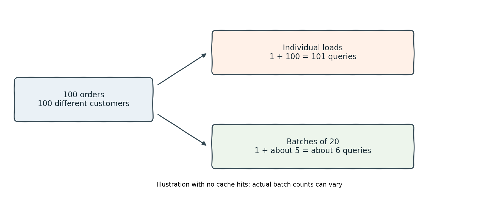

## DTO Projection

If the screen only needs order ID, total, and customer name, return exactly those values:

```java
package com.example.dto;
import java.math.BigDecimal;

public record OrderSummary(
    Long id, BigDecimal total, String customerName
) {}
```

```java
@Query("""
    select new com.example.dto.OrderSummary(o.id, o.total, c.name)
    from CustomerOrder o join o.customer c
    """)
List<OrderSummary> findOrderSummaries();
```

This constructor projection selects three values and creates a DTO for each row. The record is immutable and is not a Hibernate-managed entity. It has no dirty checking that writes changes back. Use DTOs for display screens, reports, and API responses.

| Need | Useful option |
|---|---|
| Entities with explicit JPQL fetching | Fetch Join |
| Required relationships per repository method | Entity Graph |
| Group lazy loads into fewer round trips | Batch Fetching |
| Selected columns for a read response | DTO Projection |

Collection fetch joins with pagination need extra care because joined rows can multiply. These examples fetch a single customer per order. Check generated SQL and query counts with realistic data.

Further reading [S163] [S164] [S165]

## AI usage hint

Use AI to suggest a fetch strategy, then inspect generated SQL and query counts. Verify the pagination and result shape with representative data.

## Interview questions and answers

**Q65 Do you always need save after changing a loaded entity?**

Not when the entity stays managed in a suitable transaction and dirty checking applies. Use save for persistence operations where needed; it does not replace the transaction boundary.

**Q66 Are save flush and commit the same?**

No. save persists or merges. Flush sends pending changes to the database. Commit completes the transaction successfully. Flushed SQL can still be rolled back.

**Q67 Why can lazy loading fail after the context closes?**

The relationship has not been loaded and its session is no longer available. Fetch the required data inside the boundary or map it to a DTO before returning.

**Q68 What is the N plus one query problem?**

One query loads a group of entities, then extra queries load related data for individual entities. Read the actual SQL and count round trips instead of guessing from annotations.

**Q69 Does EAGER loading guarantee one SQL join?**

No. It requires the relationship to be available, but the provider can use extra queries. A deliberate fetch plan is still needed.

**Q70 How can you fix N plus one queries?**

Use a suitable fetch join, entity graph, batch fetch, or DTO projection. Choose based on the result shape and pagination needs, then inspect the generated SQL.

Further reading [S13] [S14] [S16]

# Transactions and rollback

A **transaction** groups related database work. If order creation and its stock reservation must succeed together, put them inside one suitable transaction.

## The proxy boundary

Spring normally applies **Transactional** through a **proxy**. The **transaction interceptor** starts or joins the transaction, calls the method, and decides how to finish it.

An internal call such as this.saveOrder() normally bypasses that proxy. Put the boundary on the externally called operation or call a separate injected transactional bean.

## Rollback rules

By default, **RuntimeException** and **Error** trigger rollback. A checked exception needs a matching rule when rollback is required.

```java
@Transactional(rollbackFor = IOException.class)
public void placeOrder(Order order) throws IOException {
    orderRepository.save(order);
    throw new IOException("Receipt failed");
}
```

The string in @Transactional("ordersTxManager") chooses a transaction manager. It is not a rollback setting.

If a method catches its own exception and no other participant has marked the transaction for rollback, the interceptor can see normal completion and commit.

## One transaction with two intercepted calls

```java
// OrderService bean
@Transactional
public void placeOrder(Order order) {
    orderRepository.save(order);
    try {
        auditService.record();
    } catch (RuntimeException error) {
        logger.warn("Audit failed", error);
    }
}

// Separate AuditService bean
@Transactional(propagation = Propagation.REQUIRED)
public void record() {
    throw new RuntimeException("Audit failed");
}
```

**REQUIRED** shares the existing transaction. There are two intercepted method scopes, but one physical database transaction. The inner interceptor sees the exception and marks the shared transaction **rollback-only**. The outer catch does not clear that state. Commit then rolls back and reports **UnexpectedRollbackException**.

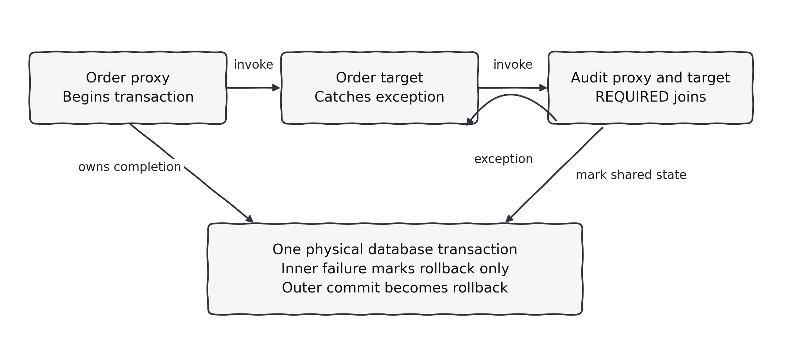

| Propagation | Simple meaning |
|---|---|
| REQUIRED | Join the current transaction or start one |
| REQUIRES_NEW | Use an independent transaction |
| NESTED | Use savepoint behavior where the manager supports it |

**REQUIRES_NEW** can keep an audit of an attempted operation even if the order rolls back. Choose the audit meaning carefully: it must not claim the order committed when it did not. Independent transactions can need extra connections.

**readOnly=true** expresses read intent and can reduce persistence work. It does not universally block writes or automatically send reads to a replica.

## AI usage hint

Ask AI to draw proxy calls and transaction boundaries. Confirm rollback and concurrency using integration tests; a plain mock test does not prove transaction behavior.

## Interview questions and answers

**Q71 What does Transactional do?**

It defines a transaction boundary around an intercepted operation. Participating database changes can then commit together or roll back together.

**Q72 What does the transaction interceptor do?**

It reads the transaction settings, starts or joins a transaction, calls the method, then decides whether to commit or roll back. It runs around the target method.

**Q73 Why can self invocation bypass Transactional?**

An internal call on the same object normally bypasses the Spring proxy. Call a separate injected transactional bean or put the boundary on the externally called operation.

**Q74 Which exceptions trigger rollback by default?**

RuntimeException and Error trigger rollback under the default rules. Checked exceptions do not. Configure rollbackFor when a checked failure must roll back the work.

**Q75 How do you roll back for IOException?**

Use @Transactional(rollbackFor = IOException.class) on an intercepted method. The string argument to Transactional selects a transaction manager; it is not a rollback rule.

**Q76 What if a transactional method catches its own exception?**

If no other boundary or resource marked rollback-only, the interceptor can see normal completion and commit. Catching an error does not automatically mean the operation should be considered successful.

**Q77 What does REQUIRED propagation mean?**

Join the current transaction if one exists; otherwise start one. Separate intercepted REQUIRED methods can share one physical database transaction.

**Q78 Why can catching an inner REQUIRED exception still end in rollback?**

The inner interceptor may have marked the shared transaction rollback-only. The outer catch does not remove that marker. Commit then fails with UnexpectedRollbackException.

**Q79 What does REQUIRES_NEW change?**

It uses an independent transaction while the outer one is suspended. Its commit or rollback is separate. It needs a real proxy crossing and often another database connection.

**Q80 What is the benefit of readOnly true?**

It tells the stack that the operation is intended to read. It can reduce tracking or flush work. It is not a universal write lock and does not automatically select a replica.

**Q81 Does a database transaction include an email provider?**

No, not in an ordinary local transaction. A database rollback cannot recall a sent email. Use a durable workflow when the external action must be recovered.

Further reading [S17] [S18] [S19]

# Concurrency

Start by finding **shared mutable state**: data that several threads can change. A singleton service can be used by many requests at the same time.

## Atomic counters

count++ reads a value, adds one, and writes it back. Two threads can lose an update. **volatile** helps visibility but does not make that whole operation atomic.

```java
private final AtomicInteger requests = new AtomicInteger();

public int generateReport() {
    return requests.incrementAndGet();
}
```

**incrementAndGet** returns the new value. **getAndIncrement** returns the old value. This counter belongs to one process. Several app replicas still have separate counters.

For a shared volatile int count, count++ still means read, add, write. Two threads can both read 5 and both write 6, losing one increment. AtomicInteger.incrementAndGet() makes that update atomic, so two increments starting from 5 finish at 7. Atomicity of one counter does not protect a larger multi-field operation.

## Parallel result collection

This is unsafe because all tasks change the same ArrayList:

```java
List<Product> products = new ArrayList<>();
productIds.parallelStream().forEach(id -> {
    Product product = processProduct(id);
    products.add(product);
});
```

Return each result and let the Stream collect it:

```java
List<Product> products = productIds.parallelStream()
    .map(this::processProduct)
    .toList();
```

**toList** safely collects the returned results; it does not turn ArrayList into a thread-safe class. The mapper must still handle its own shared data safely. Database sessions and the caller's transaction do not automatically move to worker threads.

## Thread safe choices

| Ordinary choice | Concurrent option | Main caution |
|---|---|---|
| HashMap | ConcurrentHashMap | A multi-step workflow may still need coordination |
| HashSet | ConcurrentHashMap.newKeySet | Stored objects can still be mutable |
| ArrayList | Synchronized wrapper or CopyOnWriteArrayList | Match the read and write pattern |
| ArrayDeque | ConcurrentLinkedDeque or a suitable blocking queue | Choose ordering and waiting behavior |

**CopyOnWriteArrayList** suits many reads and few writes. A synchronized wrapper needs synchronization during ordinary iteration.

**computeIfAbsent** exists on Map, not only ConcurrentHashMap. It computes a value when the key is missing or mapped to null; returning null leaves no new mapping. HashMap does not make it safe for concurrent access. ConcurrentHashMap provides its own atomic operation and rejects null keys and values.

```java
cache.putIfAbsent(id, loadProduct(id));
```

Java runs loadProduct(id) before calling putIfAbsent, even if id already has a value. Two callers can both do the expensive load.

```java
cache.computeIfAbsent(id, key -> loadProduct(key));
```

Here the lambda defers loading until the map needs a value. For ConcurrentHashMap, the operation is atomic for that key. Keep the computation short; it can block other updates. It is not a durable once-only guarantee: removal, null results, or failures can allow future loads.

## Interview questions and answers

**Q82 Why is incrementing a shared int unsafe?**

Increment reads, calculates, and writes. Two threads can overwrite each other's updates. The problem is the shared compound operation, not every use of int.

**Q83 How do volatile and AtomicInteger differ?**

volatile supports visibility of writes to a field. It does not make count++ atomic. AtomicInteger provides atomic read-modify-write operations for that value.

**Q84 Why is adding to one ArrayList from parallel tasks unsafe?**

Multiple threads change the same internal storage and size without coordination. Updates can be lost or the state can become inconsistent.

**Q85 How does map followed by toList solve parallel result collection?**

Each task returns its result and the Stream implementation safely collects those results. It removes external shared-list mutation. The mapper's own side effects must still be safe.

**Q86 Is ConcurrentHashMap enough for a check then insert sequence?**

Not if the sequence must be one atomic decision. Use a suitable atomic operation such as computeIfAbsent. Thread-safe individual calls do not make every multi-step workflow safe.

**Q87 Why can putIfAbsent still run a database load twice?**

Java evaluates the load argument before calling putIfAbsent. Two callers can both load. computeIfAbsent defers the computation under that map operation's rules.

**Q88 Is Transactional alone enough to prevent overselling?**

No. Protect the stock decision with a conditional update, a version check, or a suitable lock, and keep related writes in one transaction.

**Q89 How do optimistic and pessimistic locking differ?**

Optimistic locking checks a version and rejects a conflict. Pessimistic locking makes competing operations wait for a lock. Both need failure handling; waiting can also lead to deadlocks.

Further reading [S21] [S22] [S23] [S24]

# Caching

A **cache** avoids repeating expensive reads. It creates another copy of data, so define its key, lifetime, size, and freshness rules.

Spring's **Cache Abstraction** provides annotations. The provider, such as Redis or Caffeine, stores the values. **CacheManager** selects the named caches. Enable caching and configure a provider.

| Annotation | Method behavior | Cache behavior |
|---|---|---|
| Cacheable | Can be skipped on a hit | Stores the result on a miss |
| CachePut | Runs normally | Stores the returned value |
| CacheEvict | Runs normally | Removes selected entries |

```java
@Cacheable(cacheNames = "prices", key = "#tenantId + ':' + #id")
public BigDecimal getPrice(long tenantId, long id) {
    return loadPrice(tenantId, id);
}
```

Include every input that changes the answer, especially **tenant ID**. Apply the same key rule to reads, updates, and evictions.

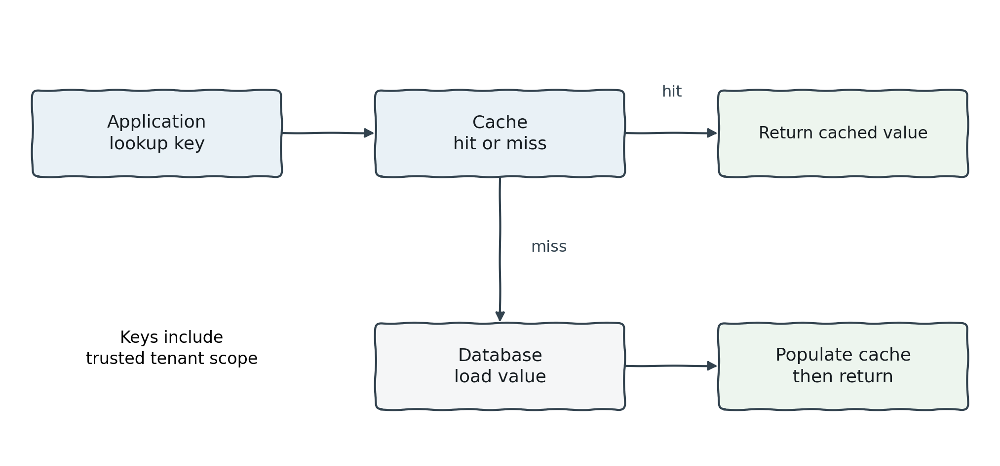

## Terms to remember

- **Cache-aside**: check the cache, read the database on a miss, then cache the result.
- **Cache miss**: the key has no usable cached value.
- **TTL**: the entry's expiry policy.
- **Cache stampede**: many callers reload the same missing value together.
- **Single flight**: overlapping loads share one in-progress result.

Single flight can be local to one process. A distributed lock has a wider scope and needs timeouts and failure handling. Do not assume Cacheable(sync=true) coordinates every app replica.

## Updates and failures

Update the database and coordinate cache invalidation with a successful commit. An older reader can still repopulate a stale value, so choose an acceptable TTL or a stronger freshness protocol when needed.

A shared **Redis** cache helps replicas use the same entries. It does not fix incorrect keys or every invalidation race. If the cache fails, protect the database from a sudden flood of fallback reads.

Cache product descriptions and display views when their freshness is acceptable. Validate the final purchase against authoritative price and stock.

## Interview questions and answers

**Q90 What does Cacheable do?**

It can return a cached result without running the target method. On a miss, the method normally runs and its result is stored. A working cache provider and interception are required.

**Q91 How do CachePut and CacheEvict differ?**

CachePut runs the method and stores its returned value. CacheEvict removes entries so later readers can reload them. A void update does not supply an updated price to CachePut.

**Q92 Why include tenant ID in a cache key?**

Different tenants can have the same product ID. The key must include the trusted tenant scope so one tenant cannot receive another tenant's cached result.

**Q93 What is a cache stampede?**

Many requests miss the same key and load it together. Single flight, bounded loading, expiry jitter, or a suitable lock can reduce the repeated work.

**Q94 Why invalidate a cache after database commit?**

It avoids publishing a value for a transaction that later rolls back. It still needs a freshness policy because an overlapping reader can repopulate an older value.

**Q95 What should happen if the cache fails?**

Use the database only if it can safely absorb the fallback load. Bound concurrency and provide an appropriate degraded response for noncritical reads.

Further reading [S26] [S27] [S28]

# Security and identity

**Authentication** checks identity. **Authorization** checks what that identity may do. A valid login does not prove ownership of the requested order.

| Term | Simple meaning |
|---|---|
| OAuth 2 | Authorization flows and delegated access |
| JWT | A token format |
| OpenID Connect | An identity layer built on OAuth |
| Keycloak | An identity provider and authorization server |
| Access token | Credential presented to a resource API |
| Refresh token | Credential used to obtain another access token |

## Check identity and resource access

For a signed JWT, verify the signature, allowed algorithm, issuer, audience, and expiry. Decoding it only reads the content. A signed token is not necessarily encrypted.

Spring request rules can protect routes. **PreAuthorize** can protect methods when **EnableMethodSecurity** is enabled and interception applies. Check ownership and tenant scope too.

```java
@PreAuthorize("hasAuthority('orders:read')")
public OrderDto getOrder(long id) {
    return orders.findByIdAndTenantIdAndCustomerId(
            id, currentTenantId(), currentCustomerId())
        .map(OrderDto::from)
        .orElseThrow(OrderNotFoundException::new);
}
```

The identity helpers must use trusted authenticated data. A tenant ID from an arbitrary request header is not enough. Scope caches, background jobs, files, and exports as carefully as database queries.

## Sessions tokens and browser protection

A **server-side session** usually stores state on the server and gives the browser an identifier. An **opaque token** is a reference checked through a trusted lookup. A signed JWT can be checked locally, but immediate revocation needs another mechanism.

Protect cookies with appropriate **HttpOnly**, **Secure**, and **SameSite** settings. **CSRF** matters when the browser automatically attaches credentials. **CORS** controls browser access to cross-origin responses; it does not authenticate a caller.

## AI usage hint

Use AI to propose abuse cases and authorization tests. Never paste live credentials, and independently review permissions and trust boundaries.

## Interview questions and answers

**Q96 How do authentication and authorization differ?**

Authentication checks who the caller is. Authorization checks what that caller may do, including access to this resource and this tenant.

**Q97 How do OAuth JWT and OpenID Connect differ?**

OAuth defines authorization flows. JWT is a token format. OpenID Connect adds an identity layer over OAuth. An OAuth access token can be a JWT or an opaque token.

**Q98 How do access and refresh tokens differ?**

An access token goes to the resource API. A refresh token goes to the authorization server to obtain another access token under its policy. Protect refresh tokens carefully.

**Q99 Does decoding a JWT prove it is valid?**

No. Verify its signature, allowed algorithm, issuer, audience, expiry, and other required claims. Readable token content is not proof of trust.

**Q100 How do CORS and CSRF differ?**

CORS controls browser access to cross-origin responses. CSRF involves unwanted actions using credentials the browser sends automatically. CORS is not authentication or a substitute for CSRF protection.

**Q101 What is the tradeoff between sessions JWTs and opaque tokens?**

Sessions and opaque tokens normally need a server-side lookup. A signed JWT can be checked locally, but immediate revocation needs an extra design. Choose based on the required behavior.

Further reading [S29] [S31] [S32] [S123]

# Async work and application events

**Async** work lets the caller continue while another task runs. It can reduce response waiting, but the task still needs time and resources.

Enable **EnableAsync** and call a separate injected bean through the Spring proxy. Choose a **bounded executor** with a clear queue and rejection policy.

## Observe the result

```java
@Async("reportExecutor")
public CompletableFuture<String> generateReport(long id) {
    String location = reportWriter.write(id);
    return CompletableFuture.completedFuture(location);
}

// Caller uses the injected report service
reportService.generateReport(id)
    .whenComplete((location, error) -> {
        if (error != null) logger.error("Report failed", error);
        else logger.info("Report ready at {}", location);
    });
```

**reportExecutor** is the name of the Spring Executor bean used to run this task:

```java
@Configuration
@EnableAsync
class AsyncConfig {
    @Bean("reportExecutor")
    ThreadPoolTaskExecutor reportExecutor() {
        ThreadPoolTaskExecutor executor = new ThreadPoolTaskExecutor();
        executor.setCorePoolSize(2);
        executor.setMaxPoolSize(4);
        executor.setQueueCapacity(50);
        executor.setThreadNamePrefix("report-");
        return executor;
    }
}
```

Spring manages this executor. Test pool limits for your workload. The proxy submits work, and the executor runs it. The reportWriter and service classes are omitted here. **CompletableFuture** lets the caller observe completion. **join** waits and can expose a CompletionException. Waiting is still blocking.

For a **void** async method, a caller's try/catch cannot catch a later execution failure on the worker. Configure **AsyncUncaughtExceptionHandler**. A task rejected during submission can still fail synchronously.

## Transactions and reliable work

The caller's ordinary thread-bound transaction does not automatically move to the worker. A worker can start a separate transaction through a suitable transactional bean. It may commit even if the caller later rolls back.

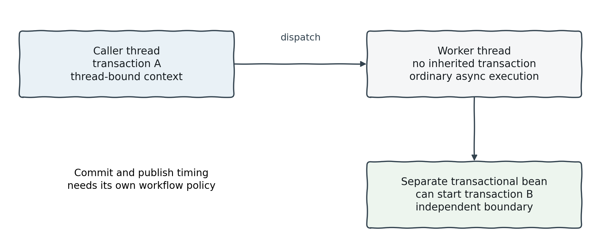

An **AFTER_COMMIT** event listener waits for successful transaction completion. It is useful when that timing is enough. An in-memory task can still disappear if the process crashes.

When recovery matters, persist the work before acknowledging it. Use an **Outbox** and durable queue for notification intent, then retry safely. The messaging chapter explains the flow.

## Interview questions and answers

**Q102 What does Async change?**

An intercepted Async call submits work to an executor. The caller can continue before that work finishes. This reduces caller waiting; it does not necessarily reduce the work's duration.

**Q103 Why can a try catch miss an exception from a void async method?**

The method can fail later on another thread. Use AsyncUncaughtExceptionHandler for execution failures of void async methods. Submission failures, such as rejection, can still reach the caller immediately.

**Q104 When should an async method return CompletableFuture?**

Use it when the caller needs to observe success, failure, or a result. Attach completion handling. Calling join waits, so it blocks the calling thread.

**Q105 Does the caller transaction automatically move to an async thread?**

No, in the ordinary thread-bound transaction model. A worker can start its own transaction through a separate transactional boundary. Its result is independent of the caller's transaction.

**Q106 Why use a bounded executor?**

It limits workers and queued tasks. Without limits, overload can become high memory use and long waiting. Decide what happens when submission is rejected.

**Q107 Is an application event enough for reliable notifications?**

No. A process crash can lose in-memory work. If delivery must be recovered, persist the intent and use a durable queue or another recoverable workflow.

Further reading [S34] [S35] [S36] [S37]

# Testing

Test the behavior that could fail. Use fast **unit tests** for business decisions, then cross real boundaries when testing SQL, transactions, security, or integration behavior.

| Test choice | Useful purpose |
|---|---|
| JUnit and Mockito | Small business rules with controlled dependencies |
| WebMvcTest | Routing validation responses and configured filters |
| DataJpaTest | Entity mapping and repository behavior |
| SpringBootTest | Application integration with configured components |
| RANDOM_PORT | Real HTTP server behavior |
| Testcontainers | Real dependencies such as PostgreSQL |

## A small unit test

```java
@ExtendWith(MockitoExtension.class)
class OrderingServiceTest {
    @Mock StockService stock;
    @Mock PaymentService payments;
    @InjectMocks OrderingService service;

    @Test
    void rejectsUnavailableStockBeforePayment() {
        when(stock.available(1L)).thenReturn(0);
        assertThrows(OutOfStockException.class,
            () -> service.placeOrder(1L));
        verifyNoInteractions(payments);
    }
}
```

This test checks the business decision and that payment is not called. **InjectMocks** does not create a Spring proxy. Use a Spring integration test to verify actual transaction interception.

**Mock** is a Mockito double. **MockitoBean** changes a bean in a Spring test context. For PostgreSQL-specific behavior, use PostgreSQL rather than assuming another database behaves the same.

## Useful failure cases

- Confirm rollback through the real proxy and commit boundary.
- Check duplicate requests, timeouts, and safe retry.
- Verify tenant and resource ownership, including denied cases.
- Count SQL when testing an N+1 fix.
- Stop an Outbox worker at a failure boundary and check recovery.

A test transaction can hide a commit failure or keep lazy data accessible longer than production. A real HTTP server also runs on a different thread from the test client. Match the test to the behavior you want to prove.

## AI usage hint

Use AI to draft failure cases and assertions. Review what each test proves, what it mocks, and whether it can fail for the right reason.

## Interview questions and answers

**Q108 How do unit and integration tests differ?**

A unit test checks a small behavior with controlled dependencies. An integration test checks real interactions, such as SQL, transactions, security filters, or service boundaries.

**Q109 How do Mock and MockitoBean differ?**

Mock creates a Mockito double for the test. MockitoBean replaces or supplies a bean in a Spring test context. A plain Mockito test does not create Spring transaction interception.

**Q110 When should you use WebMvcTest?**

Use it for focused MVC behavior such as routing, request validation, responses, and configured security filters. Supply the controller's required collaborators.

**Q111 When should you use DataJpaTest?**

Use it for repository and persistence behavior. For database-specific SQL or locking, use the same database engine as production, often through Testcontainers.

**Q112 Does SpringBootTest start a real web server by default?**

No. Use an appropriate webEnvironment such as RANDOM_PORT when the test needs real HTTP handling. A loaded context is not automatically a real-server test.

**Q113 Why can a rollback test give false confidence?**

The test may never reach commit, share an enclosing transaction, or keep lazy data accessible longer than production. Verify the real boundary for the behavior being tested.

**Q114 How would you test duplicate payment requests?**

Send repeated and competing requests with the same operation key. Verify one logical payment and a consistent recoverable result, including timeout and crash cases.

Further reading [S39] [S40] [S41]

# PostgreSQL and SQL plans

Use execution plans to explain where database time goes. Focus on scan choices, row estimates, repeated work, buffers, and the effect of indexes.

## Read an execution plan

**EXPLAIN** shows estimates. **EXPLAIN ANALYZE** runs the statement and adds observations. **BUFFERS** adds database block-access information. ANALYZE also executes write statements, so use a suitable practice environment for them.

```sql
EXPLAIN (ANALYZE, BUFFERS)
SELECT id, total
FROM orders
WHERE customer_id = 101;
```

The plan below uses example numbers to explain the fields. It is not a measured database result.

```text
Seq Scan on orders
  (cost=0.00..22000.00 rows=20 width=16)
  (actual time=0.050..180.000 rows=20 loops=1)
  Filter: (customer_id = 101)
  Rows Removed by Filter: 999980
  Buffers: shared hit=7000 read=2500
```

The scan returned 20 rows but filtered nearly a million. For this selective lookup, investigate an index. A small table or a query returning most rows may still suit a sequential scan.

| Field | What to say in the interview |
|---|---|
| cost | Estimated planner cost units, not milliseconds |
| rows | Expected or actual output rows from that node |
| actual time | Time to first row and completion, in milliseconds |
| loops | Repeated executions; actual figures are per-loop averages |
| buffers hit | Block found in PostgreSQL shared buffers |
| buffers read | Block loaded into shared buffers, possibly from OS cache |

Read the tree from the scans upward. Compare estimates with observations, look for repeated inner work, and inspect large filters or disk spills. Parent time includes child time, so adding every node's time double counts work.

## Common plan operations

| Operation | Simple meaning |
|---|---|
| Seq Scan | Read table data sequentially |
| Index Scan | Find index entries and fetch table rows |
| Index Only Scan | Return indexed values when visibility allows it |
| Bitmap Heap Scan | Fetch table pages identified through a bitmap |
| Nested Loop | Repeat an inner operation for outer rows |
| Hash Join | Build and probe a hash structure |
| Merge Join | Combine suitably ordered inputs |

For recent orders, this index can support customer filtering and the requested order:

```sql
CREATE INDEX idx_orders_customer_recent
ON orders (customer_id, created_at DESC, id DESC);
```

Every index costs storage and write work. Measure the result after adding one. Use **ANALYZE orders** to update statistics; that is different from EXPLAIN ANALYZE. Avoid deep offsets and repeated application queries when they are the actual source of the delay.

## AI usage hint

Share a sanitized plan and schema, not production secrets or personal data. Use AI for hypotheses; validate them with observed plans and workload measurements.

## Interview questions and answers

**Q115 What should you inspect first in a slow query plan?**

Compare estimated and actual rows, then inspect large filters, repeated inner work, and buffer access. Follow the plan from its scans upward to see where unnecessary work begins.

**Q116 Why might PostgreSQL ignore an existing index?**

The index may not match the filter or ordering, or the query may need a large share of the table. A sequential scan can be cheaper. Check the plan and data distribution before adding another index.

**Q117 What does a sort spilling to disk tell you?**

The sort needed more memory than its available budget and used temporary disk space. Inspect the sort method and disk usage. Consider reducing the input or using a suitable ordered index before changing memory settings for the workload.

**Q118 How should you validate a query tuning change?**

Compare plans and observed execution on representative data, check that results remain correct, and measure the whole API request. Include index storage and write costs; one faster query does not prove the complete workload improved.

**Q119 How do EXPLAIN and EXPLAIN ANALYZE differ?**

EXPLAIN shows the plan and estimates. EXPLAIN ANALYZE executes the statement and adds observed row counts and timing. BUFFERS adds information about database block access.

**Q120 Is the cost in an execution plan measured in milliseconds?**

No. Cost uses planner units. Actual time from EXPLAIN ANALYZE uses milliseconds. Keep estimated cost separate from measured execution time.

**Q121 Is a sequential scan always bad?**

No. It can be efficient for a small table or a large share of its rows. Investigate scans that do much work to return a small selective result.

**Q122 What does a large estimated versus actual row difference suggest?**

Check statistics, uneven data, and related filter conditions. Bad row estimates can lead to poor join choices. Find where the plan first becomes inaccurate.

**Q123 Why do loops matter in an execution plan?**

A small inner operation repeated many times can become expensive. Actual row and time figures are per-loop averages when loops exceed one, so consider the loop count.

**Q124 What is the difference between buffer hits and reads?**

A hit finds a block in PostgreSQL's shared buffers. A read loads it into those buffers and may still use the operating system cache. Neither value is a row count.

**Q125 Can a fast SQL plan still belong to a slow API?**

Yes. The request may wait for a connection, a lock, many separate queries, or an external service. Measure the whole request as well as the SQL.

Further reading [S42] [S43] [S68] [S71]

# System requirements and capacity

Start with the users, important operations, and correctness rules. Ask about **launch scope**, traffic, latency, availability, budget, and team size. Make assumptions visible.

## APIs and service boundaries

Design the **API** around user operations and honest outcomes. An order can be created while payment is pending. Give the client an order ID and a way to check state. Keep identity, error behavior, pagination, and retry rules explicit.

**Synchronous** work keeps the caller waiting for its result. **Asynchronous** work continues after the caller returns and needs a way to observe completion. Move an email off checkout when it can finish later; keep the stock decision in the required order boundary.

A **monolith** is deployed as one application. A **modular monolith** keeps clear modules inside that application. **Microservices** add independent deployment boundaries, but also network failures, distributed data, monitoring, and support work. Choose them for a clear scaling or ownership need, with a team that can operate them.

## A small capacity example

The numbers below are practice assumptions, not production measurements.

| Input | Assumption | Why it matters |
|---|---|---|
| Daily orders | 100000 | Storage and average workload |
| Peak orders | 500 per minute | Capacity and spike tests |
| Read to write request ratio | 10 to 1 | Read-path load |
| Retention | One year | Data growth |
| Local API target | p95 below 300 ms | Latency budget |

500 orders per minute is about **8.33 orders per second**. With ten read requests for each order-creation request, total API demand is about 91.7 requests per second under this model. That is not the SQL or disk operation rate.

**Headroom** needs a definition. Capacity 25 percent above the peak means 625 orders per minute. Keeping 25 percent of capacity unused while serving 500 means capacity of about 667 per minute.

## CPU memory disk and cost

- **vCPU** is a virtual CPU unit. Its relationship to physical cores depends on the instance family.
- **CPU demand** depends on CPU time per request, not time spent waiting for a remote service.
- **RAM** includes application memory, buffers, caches, and runtime overhead.
- **IOPS** is storage input/output operations per second.
- **Disk throughput** is bytes transferred per second.
- **Write contention** means competing operations need the same writable resource.

As rough arithmetic, 100 requests per second using 20 ms of CPU each need two CPU-seconds of work per second before overhead and failure allowance. Validate this with a profiler and load test; it is not an instance-size recommendation.

If an order adds 2 KB of logical data, 100000 orders add about 200 MB per day. Indexes, logs, related records, backups, and replicas increase actual storage.

Budget for compute, database, storage, backups, traffic, load balancers, NAT, monitoring, and engineering support. Use current Region-specific prices when making a real estimate.

## Find the bottleneck

| Evidence | Investigate first |
|---|---|
| High database CPU | Expensive queries or too much concurrent work |
| High pool waiting | Long-held connections and total connection budget |
| Many waits on one row | Hot key or long transaction |
| High disk latency | Access pattern memory or storage limits |
| Many small SQL queries | N+1 or an unsuitable result shape |
| Slow external requests | Dependency latency timeouts and concurrency |

Increasing the wrong resource adds cost without fixing the wait. A bigger database can help CPU pressure, but may not fix requests queued on one stock row.

## Load testing

Use **JMeter** with realistic request mixes and business checks. Run gradual load, steady load, spikes, and slow-dependency tests. Monitor the generator too, so it does not become the bottleneck.

```bash
jmeter -n -t checkout.jmx -l results.jtl -e -o report
```

The command assumes your own configured test plan and a new report directory. Check successful orders, **p95**, **p99**, **error rate**, and resource use. Do not treat a 200 response as proof that the order workflow completed.

## AI usage hint

Use AI to check arithmetic and list assumptions. Validate units, peak traffic, and resource limits; generated capacity numbers are not benchmarks.

## Interview questions and answers

**Q126 What should you ask before drawing a system design?**

Ask who uses it, which operations matter, expected traffic, correctness rules, latency, availability, budget, and launch scope. State assumptions when numbers are missing.

**Q127 When should you choose microservices over a monolith?**

Choose them when separate scaling, releases, or team ownership justify the extra network and data work. A modular monolith can be a practical starting point when those needs are small.

**Q128 What does 25 percent headroom mean?**

Define it. Capacity 25 percent above demand means multiply demand by 1.25. Keeping 25 percent of capacity unused means divide demand by 0.75.

**Q129 How do latency and throughput differ?**

Latency is how long one operation takes. Throughput is completed work per unit of time. A system can accept more work than it completes for a while, but waiting then grows.

**Q130 What is write contention?**

Operations compete for the same writable resource, such as the final stock row. More app replicas can increase waiting instead of increasing useful throughput.

**Q131 Can you choose an instance size from orders per second alone?**

No. Estimate the work per order, then measure CPU, memory, disk, connections, and dependencies under representative load. Include failure capacity and cost.

**Q132 What should a JMeter load test measure?**

Achieved traffic, successful business operations, latency percentiles, errors, and resource limits. Include spikes and slow dependencies. A 200 response alone does not prove that an order was saved.

Further reading [S118] [S119] [S120] [S141]

# Data modeling

Choose storage from the data relationships, access patterns, and correctness rules. A **relational database** is a useful starting point for orders and inventory because it supports transactions, constraints, and joins.

## SQL or NoSQL

**SQL databases**, such as PostgreSQL and MySQL, store related data in tables. **NoSQL databases** include document, key-value, and graph databases. NoSQL usually means Not Only SQL; it describes several models, not one behavior.

| Question | SQL database | NoSQL database |
|---|---|---|
| Data model | Related tables | Documents, key-value pairs, graphs, or others |
| Relationships | Joins and foreign keys | Often embedding or application-managed references |
| Structure | Defined schema | Often more flexible; rules still matter |
| Good starting point | Related business data and complex queries | A model matching specific access patterns |

For orders, payments, and inventory, **PostgreSQL** is a useful default: order_items references orders and products, constraints protect relationships, and a transaction can save an order and its items together.

A **document database**, such as MongoDB, can suit a catalog where product attributes vary and related information is usually read as one document:

```json
{"id":"p1","name":"Laptop","attributes":{"ram":"16GB","storage":"512GB"}}
```

Another product might have size and color instead. PostgreSQL also supports JSON, so flexible fields alone do not require another database. A **key-value database**, such as Redis, fits direct key lookups for cached products or sessions; persistence and recovery settings still matter.

Do not say NoSQL has no transactions, SQL cannot scale, or NoSQL is always faster. Capabilities differ by database. Start with relationships, queries, transaction needs, and traffic. Add another store only when its benefit justifies the extra operational work.

Further reading [S166] [S167]

## Normalization

**Normalization** reduces accidental duplication and the problems it creates.

- **1NF**: avoid repeating groups; use one value from the intended domain in each field.
- **2NF**: non-key attributes must depend on the full candidate key, not only part of a composite key.
- **3NF**: in a simple design, move facts that depend on another non-key attribute into their own table.

For example, a line identified by order_id and product_id can store quantity. The current product name belongs with Products, and current customer details belong with Customers. This is the practical interview explanation; complex key structures need the fuller formal definitions.

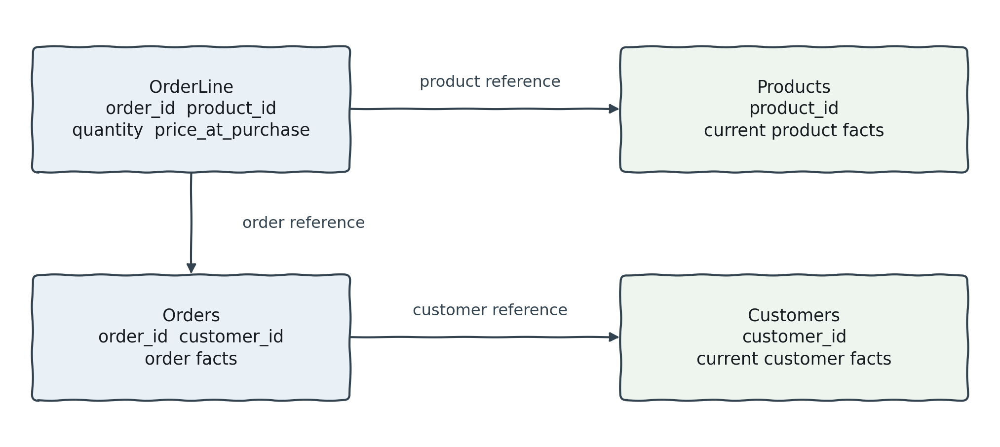

An **update anomaly** means copies disagree after a change. An **insertion anomaly** means one fact cannot be stored without inventing another. A **deletion anomaly** means deleting one record accidentally removes a different fact.

An order's **purchased price** is an intentional historical snapshot. It may differ from the current catalog price. Define the meaning instead of treating every duplicate-looking field as a mistake.

## Constraints and indexes

Use **primary keys**, **foreign keys**, **unique constraints**, **NOT NULL**, and suitable **CHECK constraints** for rules the database can enforce. For tenant-owned data, references should prevent accidental cross-tenant relationships where required.

| Index | Useful for |
|---|---|
| B-tree | Equality ranges and matching ordered reads |
| Hash | Supported equality comparisons |
| GIN | Suitable tags array and jsonb containment searches |

Index the actual filter and ordering pattern. An unused index still costs disk and write work. **Denormalization** can help a measured read path, but it also needs an update and freshness policy.

## Interview questions and answers

**Q133 When is a relational database a useful choice?**

When related data needs transactions, constraints, joins, and clear correctness rules. Orders and inventory are common examples. Choose from access and consistency needs, not fashion.

**Q134 How do the first three normal forms help?**

First normal form avoids repeating groups. Second removes partial dependencies on a composite key. Third removes unsuitable dependencies through non-key attributes. This reduces accidental duplication and update problems.

**Q135 Why use database constraints when the application validates input?**

Constraints protect the shared data against competing requests and other writers. Use uniqueness, references, and suitable checks to enforce rules the database can express.

Further reading [S116] [S135] [S140]

# Transactions and distributed data

## ACID in simple words

| Property | Meaning |
|---|---|
| Atomicity | Participating database changes succeed together or do not commit |
| Consistency | Encoded rules hold when the transaction completes |
| Isolation | Controls how concurrent transactions affect each other |
| Durability | Committed data survives according to the database guarantees |

These properties need a boundary. One local database transaction does not automatically include a remote payment provider.

## PostgreSQL isolation

| Level | What to remember |
|---|---|
| Read Uncommitted | Behaves as Read Committed in PostgreSQL |
| Read Committed | A later statement can see newer committed data |
| Repeatable Read | Stable snapshot and no phantom reads in PostgreSQL |
| Serializable | Successful transactions have a serializable outcome; retries may be needed |

PostgreSQL defaults to **Read Committed**. **Repeatable Read** prevents phantom reads in PostgreSQL, but can still allow other problems such as **write skew**: two doctors each see the other on call and update different rows to go off call. A shared rule may need stronger isolation or explicit coordination.

With **Serializable**, retry the whole aborted transaction when appropriate, including the reads and decisions. Do not blindly repeat a remote payment inside that retry.

## Locks deadlocks and connection pools

**Optimistic locking** checks a version and rejects conflicting updates. **Pessimistic locking** makes competitors wait. Keep locked transactions short and avoid waiting for remote calls while holding database locks.

A **deadlock** is a cycle of waiting. A holds row 10 and needs row 20; B holds row 20 and needs row 10. PostgreSQL can abort a participant. A consistent lock order reduces this risk.

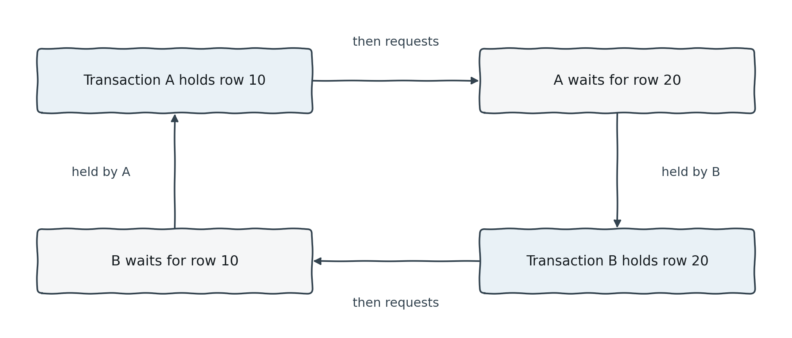

A **connection pool** reuses database connections. Waiting for a pool connection is different from running a slow query. Six API replicas with 20 connections each can request 120 connections before workers and other clients are counted. Budget connections across the whole system.

## Replication and consistency

**Replication** copies data to another instance. It can support availability, recovery, or read scaling. **Replication lag** means a replica is behind the writer.

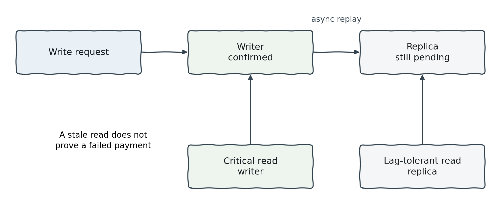

After a payment write, use an appropriate authoritative read or a deliberate **read-your-writes** mechanism. An old replica result does not prove payment failed.

**Strong consistency** needs a specific meaning, such as a single up-to-date order decision. **Eventual consistency** means copies converge when updates stop and the system can make progress; it does not promise a fixed delay by itself.

## Partitioning sharding and CAP

**Partitioning** divides data into pieces, such as monthly tables inside one PostgreSQL database. **Sharding** distributes data ownership across database nodes. Sharding adds routing, cross-shard operations, and recovery work.

During a network partition, **CAP** says that, under its model, a system cannot guarantee both a single linearizable view and an available response to every request at nonfailed nodes. Describe the operation: a stock write may wait or fail when it cannot reach the authority, while an allowed cached menu read may continue. CAP consistency and ACID consistency mean different things.

## Interview questions and answers

**Q136 What does ACID stand for?**

Atomicity, Consistency, Isolation, and Durability. They describe a database transaction's behavior within its boundary. They do not automatically include a remote email or payment provider.

**Q137 What is PostgreSQL's default isolation level?**

Read Committed. A later statement can see newer committed data. PostgreSQL treats Read Uncommitted as Read Committed, so dirty reads are still prevented.

**Q138 Does PostgreSQL Repeatable Read allow phantom reads?**

No. PostgreSQL prevents them at that level, although the SQL standard allows them. Other anomalies, such as write skew across different rows, can still occur.

**Q139 What does Serializable isolation require from the application?**

Handle possible transaction aborts and retry the whole transaction when appropriate. Include the reads and decisions in the retry. Keep remote side effects safe from repetition.

**Q140 How do a deadlock and a long lock wait differ?**

A deadlock contains a cycle of transactions waiting on each other. A long wait can happen without a cycle. Use a consistent lock order and keep transactions short.

**Q141 Why can a replica return old data after a successful write?**

Replication can lag behind the writer. Read critical confirmation from an appropriate authoritative source or use a deliberate read-your-writes design.

**Q142 How do partitioning and sharding differ?**

Partitioning divides a dataset into pieces, often inside one database. Sharding distributes data ownership across database nodes. Sharding adds routing, coordination, and recovery work.

**Q143 What does CAP mean during a network partition?**

Under the theorem's model, a system cannot guarantee both a single linearizable view and an available response to every request at nonfailed nodes. Explain the chosen behavior for the operation.

Further reading [S20] [S25] [S47] [S122] [S121]

# Messaging and consistency

**Kafka** stores a partitioned event log that supports retention and replay. An **offset** is a record position within one partition, not a global position across the topic.

A **queue** shares work between workers. **Publish/subscribe** sends an event to independent subscribers. For example, SNS can publish an order event to separate SQS queues for notifications and analytics.

## Delivery and idempotency

| Guarantee | Main point | Application concern |
|---|---|---|
| At most once | No redelivery under the stated contract | Work can be lost |
| At least once | Delivery can repeat while seeking success | Prevent duplicate effects |
| Exactly once | A defined effect occurs once within a specific scope | Check what systems are included |

**Exactly once** at a broker does not automatically include an email or payment provider.

An **idempotency key** identifies one logical operation across retries. Store its state, a request fingerprint, and its result. Enforce uniqueness in the database. Reject a different payload using the same key.

Use a stable provider-supported key for remote payment attempts too. A local database flag cannot make an arbitrary remote request atomic with your transaction.

## Outbox and Inbox

An **Outbox** stores the business change and event intent in one local database transaction. A worker publishes committed events and records progress. A crash after publishing can cause another publication.

A **Transactional Inbox** stores a unique event receipt and the receiving service's local data change in one transaction. It protects that local effect from duplicate delivery.

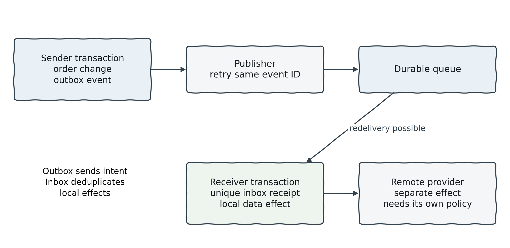

Keep the event ID stable across retries. For a remote email or payment effect, use the provider's duplicate-prevention support or define the remaining duplicate risk explicitly.

## Saga and ordering

A **Saga** uses local commits and **compensating actions**. For example, reserve stock, request payment, then confirm the order. If the workflow cannot finish, release stock or request a refund. Compensation can also fail, so it needs retry or review.

**Choreography** lets services react to events. **Orchestration** gives one component control of the workflow. **Step Functions** is a workflow service; **DynamoDB** is a database a workflow may use.

Define **event ordering** per useful key, such as an order ID. Check versions or allowed transitions so an old event cannot replace newer state. Monitor queue age, retries, and dead-letter work, with an owner for recovery.

## Interview questions and answers

**Q144 How do a queue and publish subscribe differ?**

Queue workers share tasks. Publish/subscribe gives independent subscribers their own event delivery path. SNS with separate SQS queues is one AWS example of fanout.

**Q145 How do at most once and at least once delivery differ?**

At most once avoids redelivery under its contract but can lose work. At least once can repeat delivery while seeking success. Consumers must handle duplicates safely.

**Q146 Does exactly once messaging guarantee one external payment charge?**

Only if the stated guarantee includes that payment effect. Ordinary broker guarantees do not automatically include a remote provider. Use provider-supported idempotency and recovery.

**Q147 What does an idempotency key do?**

It identifies one logical operation across retries. Store its state and result, enforce uniqueness, and reject a different payload using the same key.

**Q148 What problem does the transactional Outbox solve?**

It stores the business change and event intent in one database transaction. A worker publishes later. Publication can repeat, so consumers still need duplicate handling.

**Q149 How does a transactional Inbox differ from an Outbox?**

Outbox protects sending intent. Inbox records a unique event receipt with the receiving service's local database effect. It prevents repeated delivery from repeating that protected local effect.

**Q150 What is a Saga?**

It coordinates a business operation through local commits and later compensating actions when needed. A refund or stock release is a new action, not the erasure of an earlier commit.

**Q151 How should event ordering be handled?**

Define the required scope, such as one order. Use suitable routing and version or transition checks. A late event must not blindly replace newer state.

Further reading [S38] [S104] [S105] [S132] [S138]

# Resilience and traffic spikes

When a dependency slows down, requests hold threads and connections for longer. Queues grow, clients retry, and one slowdown can spread. Limit admitted work before the system becomes overloaded.

## Timeouts retries and circuit breakers

A **timeout** bounds waiting. A payment timeout does not prove the payment failed. Reconcile the result using the same logical operation identity.

**Retry** temporary failures only when repetition is safe or protected by idempotency. Use **exponential backoff** with **jitter**, a limit on attempts, and an overall deadline. Three attempts at three nested layers can create 27 downstream calls.

A **circuit breaker** changes whether calls should be attempted based on recent outcomes.

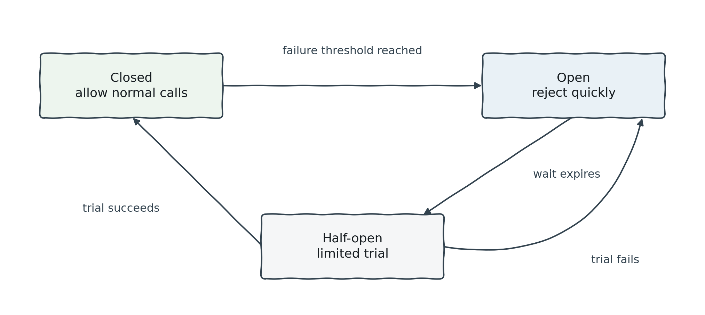

**Closed** allows calls. **Open** rejects them quickly for a period. **Half-open** allows limited trials. A fallback must report an honest state; an unavailable provider must not become a fabricated successful payment.

## Rate limits bursts and overload

**Rate limiting** controls traffic over time. A **burst** allows a short increase within a defined allowance. A token bucket with capacity 20 and refill 10 per second can allow an initial burst of 20, then about ten per second in steady use.

Use a meaningful scope, such as a tenant, user, credential, or operation. A shared limit across replicas needs coordination or an explicitly approximate policy. **HTTP 429** commonly reports a rate limit; limits also protect against accidental overload.

**Warm capacity** is already available to absorb a sudden **traffic spike**. **Autoscaling** takes time to detect load, provision resources, start the application, and pass readiness. Spare API capacity still needs spare downstream capacity.

| Control | Main purpose |
|---|---|
| Timeout | Bound waiting |
| Retry with backoff and jitter | Recover selected temporary failures |
| Circuit breaker | Avoid repeated calls to an unhealthy dependency |
| Concurrency limit | Bound work in progress |
| Rate limit | Bound admitted traffic over time |
| Load shedding | Reject some excess work to preserve useful service |

**Backpressure** asks producers to slow down or limits their submissions. A durable queue can absorb a temporary mismatch, but it still has capacity and age limits. Test recovery after overload as well as the spike itself.

## Interview questions and answers

**Q152 Why does a payment timeout mean uncertainty?**

The provider may have completed the charge before the response was lost. Reuse the same logical operation key and reconcile status instead of creating a fresh charge blindly.

**Q153 When is retry appropriate?**

Retry a temporary failure when the operation is safe to repeat or protected by idempotency. Bound attempts and total time. Repeated invalid input or denied access usually needs a different response.

**Q154 Why add jitter to exponential backoff?**

Backoff increases the delay between retries. Jitter randomizes it so many clients do not retry at the same instant and create another spike.

**Q155 What are the three circuit breaker states?**

Closed allows calls and observes results. Open rejects calls quickly for a period. Half-open allows limited trial calls to check recovery.

**Q156 How do a circuit breaker and a rate limiter differ?**

A breaker reacts to dependency health. A rate limiter controls allowed traffic over time. A concurrency limit controls how much work can stay in progress at once.

**Q157 What does a rate limit burst allow?**

A brief rate above the steady allowance, within a defined limit. For example, a full token bucket can allow an initial burst before its refill rate limits later traffic.

**Q158 What is load shedding?**

Reject part of excess work to preserve useful service. For example, pause expensive optional reports while keeping checkout available. Bound queues instead of allowing unlimited waiting.

Further reading [S55] [S53] [S130]

# Orders payments inventory and notifications

Use one complete flow to bring the ideas together. The customer should create one logical order, reserve valid stock, pay safely, and receive an update.

## Start with the rules

- The order belongs to the authenticated customer and tenant.
- Quantity is positive and available stock cannot become negative.
- Retried requests do not create another logical payment.
- Confirmation follows the allowed payment and reservation policy.
- Notification failure leaves a valid order with recoverable notification work.

Keep **order state**, **payment state**, and **reservation state** separate. A payment may be uncertain while the order is pending; a refund can remain pending after cancellation.

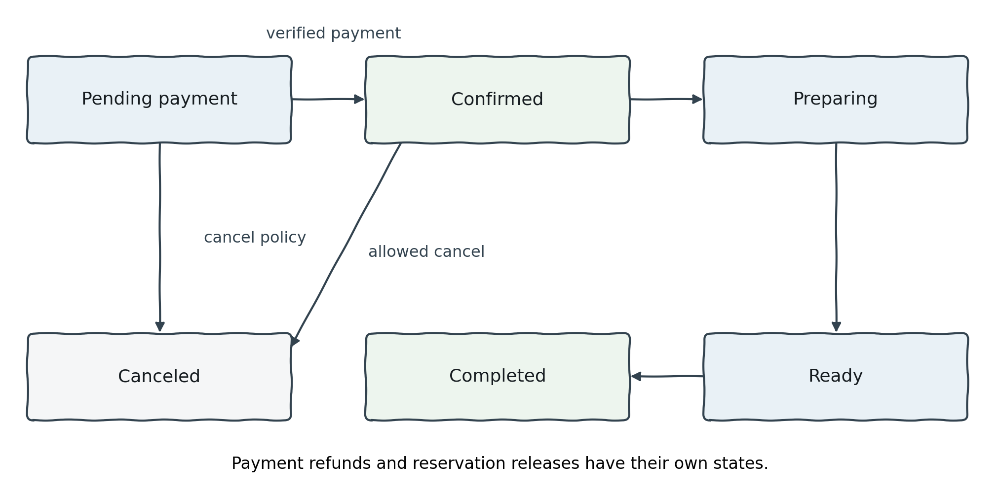

## Create and reserve

Validate the input, identity, current prices, and idempotency key. Put the order, its local stock reservation, and required Outbox intent in one database transaction when they share that database.

```sql
UPDATE inventory_example
SET available = available - :quantity
WHERE tenant_id = :tenantId
  AND product_id = :productId
  AND available >= :quantity;
```

Validate quantity > 0 and require exactly one affected row. The check and decrement form one database decision. Commit before a separate asynchronous payment step in this design.

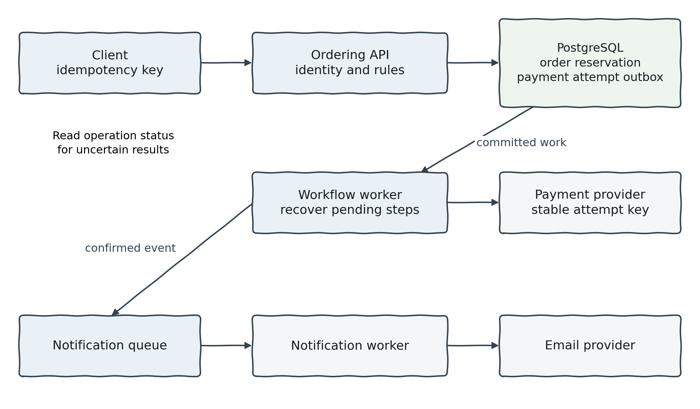

## Payment and reservation recovery

Persist a payment-attempt identity before calling the provider. Reuse its supported idempotency key. On timeout, keep an **unknown** or **pending** result and reconcile through a supported status API or webhook.

Verify webhook authenticity, operation identity, tenant, amount, and currency. Deduplicate events and apply only legal state transitions. A success redirect from the browser is not enough proof.

Reservation expiry and payment confirmation can race. Release stock only when the reservation changes from active to released in the same local transaction. Decide how to handle payment after release: reserve again, refund, or review.

| Failure | Recovery |
|---|---|
| Client loses the response | Resolve the same idempotency key |
| Worker stops after commit | Resume from durable state |
| Payment times out | Reconcile the existing attempt |
| Webhook arrives twice | Deduplicate and preserve the completed result |
| Reservation expiry runs twice | Make the release transition conditional |
| Email fails | Retry the saved notification intent |

For notifications, distinguish **accepted by provider** from **received or read by the customer**. Track the evidence your provider actually supplies.

## Interview questions and answers

**Q159 What should be atomic when creating an order?**

Put the order, related local stock reservation, and required Outbox intent in one database transaction when they share that database. Treat remote payment as a separate recoverable step.

**Q160 Why separate order payment and reservation states?**

They can change independently. An order can await payment, a payment can be uncertain, and a refund can remain pending after cancellation.

**Q161 How do you prevent two customers buying the last unit?**

Make the stock check and decrement one conditional database update, or use a suitable lock or version check. Require an affected row and commit related changes together.

**Q162 How should a payment webhook be processed?**

Verify authenticity, deduplicate the event, check the tenant, amount, currency, and payment identity, then apply a legal conditional transition. A browser redirect is not enough payment evidence.

**Q163 How do you prevent an expiry job releasing stock twice?**

Change the reservation from active to released conditionally, and return its stock in the same local transaction. A repeat run must see that release already happened.

**Q164 What if payment succeeds after the reservation expires?**

Follow an explicit policy: try a new reservation, refund, or send to review. Coordinate the state change with expiry. Do not promise both immediate release and guaranteed late fulfillment.

Further reading [S38] [S138]

# Docker and Kubernetes

An **image** packages the application and runtime. A **container** runs it. A **Pod** holds one or more closely cooperating containers. Containers in one Pod share networking and can share configured volumes.

**Docker Compose** is useful for local or single-host arrangements. **Kubernetes** schedules workloads and manages desired state across a cluster.

## Cluster nodes and control plane

A **cluster** contains the control plane and worker nodes. A **node** can be a physical or virtual machine. Worker nodes run Pods. The **control plane** decides placement and manages the requested state.

The older name **master node** usually refers to a machine hosting control-plane components. The control plane is a set of responsibilities, not necessarily one machine. AWS manages it in **EKS**.

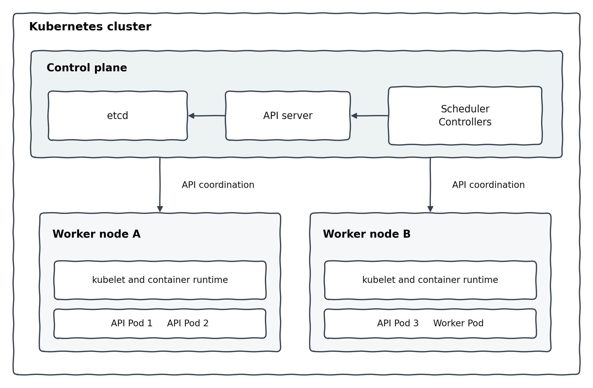

Learn these component names briefly: **API server** receives API requests; **etcd** stores cluster state; **scheduler** selects nodes; **controllers** reconcile desired state; **kubelet** manages assigned Pods on a node; **container runtime** runs containers; **CNI** supplies the configured Pod networking.

## Choose how Pods run

| Object | What it does | Simple example |
|---|---|---|
| Deployment | Keeps the required number of app copies running | Three Spring Boot API Pods |
| StatefulSet | Gives Pods stable names and links to their storage | Database Pods with separate storage |
| DaemonSet | Runs one Pod on each eligible node | Log collection agent |
| Job | Runs a task to completion | Import a file |
| CronJob | Creates Jobs on a schedule | Daily report |

StatefulSet does not configure database replication or backups. Job and CronJob runs can repeat, so repeated execution must be safe.

## CPU memory and storage

- **Requests** help Kubernetes choose a node and plan resources.
- **CPU limits** can slow a container through **throttling**. **500m** means half a CPU unit. One CPU does not mean a dedicated physical core.
- **Memory limits** can lead to **OOMKilled**, meaning killed because of an out-of-memory condition.
- With a **512Mi request** and **1Gi limit**, a container may use more than 512Mi when memory is available within its constraints.
- **Java heap** is only part of memory use. Leave room for threads, buffers, and other JVM needs.
- A Pod must fit on one suitable node. Free resources across several nodes cannot be combined to fit it.

**ConfigMap** stores ordinary configuration. **Secret** is intended for sensitive values; base64 encoding alone is not encryption. Protect access and storage appropriately.

**emptyDir** lasts for the Pod's lifetime. A **PersistentVolumeClaim** requests persistent storage. A persistent volume is still not a backup. Store required uploads and receipts outside a container's writable layer.

## Traffic probes and scaling

| Component | What to remember |
|---|---|
| Service | Stable access to a changing group of backends |
| Ingress | HTTP host and path rules that need a controller |
| API gateway | API entry with product-specific policies such as auth and rate limits |

An **Ingress resource** is configuration, not the running proxy itself. The **controller** makes the rules work. On AWS, a controller can configure an ALB; it does not necessarily carry each request.

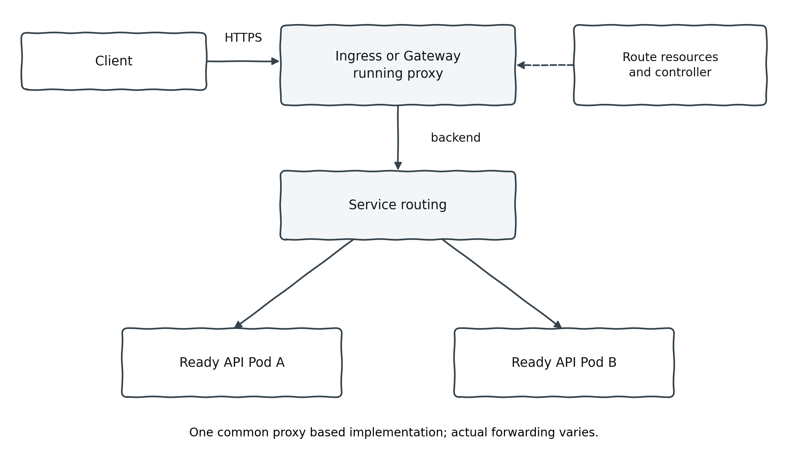

| Probe | Simple question | Failure effect |
|---|---|---|
| Readiness | Should this Pod receive normal traffic now | Removes normal traffic eligibility |
| Liveness | Is restarting an appropriate recovery | Can restart the container |
| Startup | Has startup completed | Delays the other probes until success |

Do not make every container fail liveness just because a shared database is down. Restarting the API does not repair that database.

**HPA** changes Pod count. **Cluster Autoscaler** or **Karpenter** can add suitable node capacity. **Self-healing** replaces or restarts failed work; **autoscaling** changes capacity for demand. Check database connection limits before multiplying API replicas.

For troubleshooting, start with events, readiness, and the failed path. Check logs and the previous container exit reason for **CrashLoopBackOff** or **OOMKilled**. The companion YAML is for practice and needs a real application image and environment.

## Interview questions and answers

**Q165 How do an image a container and a Pod differ?**

An image packages the application. A container runs it. A Pod is Kubernetes' smallest deployable unit and holds one or more closely cooperating containers.

**Q166 What are a cluster a node and the control plane?**

A cluster is the managed group. Nodes run workloads. The control plane manages desired state and placement. In EKS, AWS operates the managed control plane.

**Q167 When do you choose Deployment StatefulSet or DaemonSet?**

Deployment runs app copies. StatefulSet provides stable Pod identities and storage links. DaemonSet runs one Pod on each eligible node, such as a log agent.

**Q168 How do Job and CronJob differ?**

Job runs work to completion. CronJob creates Jobs on a schedule. Runs can repeat, so repeated execution must be safe.

**Q169 How do Service Ingress and API Gateway differ?**

Service gives stable access to backends. Ingress defines HTTP routing through a controller. An API gateway can add API policies such as authentication and rate limits, depending on the product.

**Q170 How do readiness liveness and startup probes differ?**

Readiness controls normal traffic eligibility. Liveness checks whether restarting is an appropriate recovery. Startup gives a slow-starting process time before the other probes judge it.

**Q171 How do resource requests and limits differ?**

Requests help scheduling and resource allocation. Limits restrict usage. CPU limits can throttle work; memory limits can lead to OOMKilled when memory is exhausted.

**Q172 Why can Java be OOMKilled before a Java OutOfMemoryError?**

The container includes more than the Java heap. Thread stacks, buffers, and other JVM memory can reach the container's memory boundary first.

**Q173 How do HPA and node autoscaling differ?**

HPA changes the number of Pods. A node autoscaler adds suitable node capacity when Pods need it. More Pods do not automatically add database capacity.

**Q174 How do self healing and autoscaling differ?**

Self-healing restores healthy desired operation after failure. Autoscaling changes capacity for demand. Neither fixes every application bug or database bottleneck.

Further reading [S73] [S75] [S76] [S78] [S80] [S51]

# Deployment observability and recovery

## See the whole request

**Logs** explain individual events. **Metrics** show counts and patterns. **Traces** show where one request spent time. Connect them with useful identifiers while keeping credentials and sensitive data out of logs.

Measure **latency**, **throughput**, **error rate**, and resource saturation. **Tail latency** describes slow requests, often shown with p95 or p99. An average can hide them. Do not average precomputed p99 values across replicas to claim a fleet p99.

| Term | Simple meaning | Example |
|---|---|---|
| SLI | Measured service behavior | Fraction of eligible successful checkouts |
| SLO | Target for that behavior | 99.9 percent over a defined window |
| SLA | Agreement with the customer | Commitment and remedies in the contract |

An SLI is not always a percentage; latency or freshness can be useful indicators too. For one million eligible requests and a 99.9 percent success SLO, the allowed unsuccessful count is 1000. That does not directly define downtime minutes.

## Deploy and migrate safely

Use identifiable image versions, readiness, graceful shutdown, and a checked rollout. A running process is not proof that checkout works. Watch business outcomes during deployment.

For a schema change, use **expand migrate contract**. Add compatible fields, let old and new code coexist, backfill and verify existing data, then remove the old structure later.

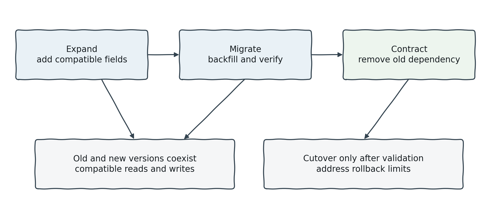

A **backfill** populates existing records. Run it in bounded, resumable batches and avoid overwriting newer writes. **Schema evolution** also includes API and event contracts. Rolling back code does not automatically reverse a destructive data migration.

## Recovery and incidents

**RTO** is the target time to restore service. **RPO** is the acceptable data-loss window measured in time. For example, RTO 30 minutes and RPO 5 minutes need a tested recovery path that fits both targets.

A replica can copy a deletion, so keep backups and the log history needed for **point-in-time recovery**. Restore to a controlled destination, validate data and application behavior, then plan traffic return.

During an incident, assign coordination, investigation, and communication roles as needed. Restore useful service first, then reconcile uncertain payments and queued work. Finish with a postmortem and owned follow-up actions.

## AI usage hint

Use AI to summarize sanitized logs and form a timeline. Verify the evidence and use controlled rollout or recovery procedures for production changes.

## Interview questions and answers

**Q175 How do logs metrics and traces differ?**

Logs describe individual events. Metrics show patterns and counts. Traces show where one request spent time. Use them together to connect a user problem to its cause.

**Q176 How do SLI SLO and SLA differ?**

SLI is what you measure. SLO is the target for that measure. SLA is the agreement with the customer, including its terms and any consequences for missing them.

**Q177 Why look at p95 or p99 instead of only the average?**

An average can hide slow requests. Percentiles show the slower part of the distribution. Compare the same route, outcome, and time window; do not average replica p99 values.

**Q178 How do you change a database schema safely during a rollout?**

Add compatible fields, deploy code that supports the transition, backfill and verify existing data, then remove the old shape later. This is expand, migrate, contract.

**Q179 How do RTO and RPO differ?**

RTO is the target time to restore service. RPO is the acceptable data-loss window measured in time. Test recovery against both targets.

**Q180 Does a replica replace a backup?**

No. A replica can copy accidental deletion or bad data. Backups and retained logs can support recovery to an earlier point. Rehearse the restore and application checks.

Further reading [S48] [S52] [S111] [S142]

# AWS and GCP

Choose services from the job they do, their limits, and the team that will run them.

## Networks and request routing

A **Region** contains separate **Availability Zones**. In AWS, a **VPC** is your regional virtual network. Each **subnet** belongs to one zone.

In a conventional IPv4 design, a **public subnet** has a direct route to an **Internet Gateway**. A **private subnet** does not. Individual resources still need the right addresses, routes, and security rules.

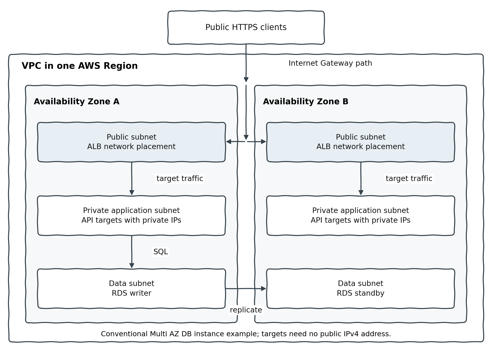

An internet-facing **ALB** can sit in public subnets and forward to private API targets. The database can remain in private data subnets. The API targets do not need public IPv4 addresses for this path.

A public **NAT Gateway** lets appropriately routed private IPv4 resources start outbound internet connections. It belongs in a public subnet for this design. It is not an inbound customer API load balancer. **VPC endpoints** can provide private paths to supported AWS services without that NAT route.

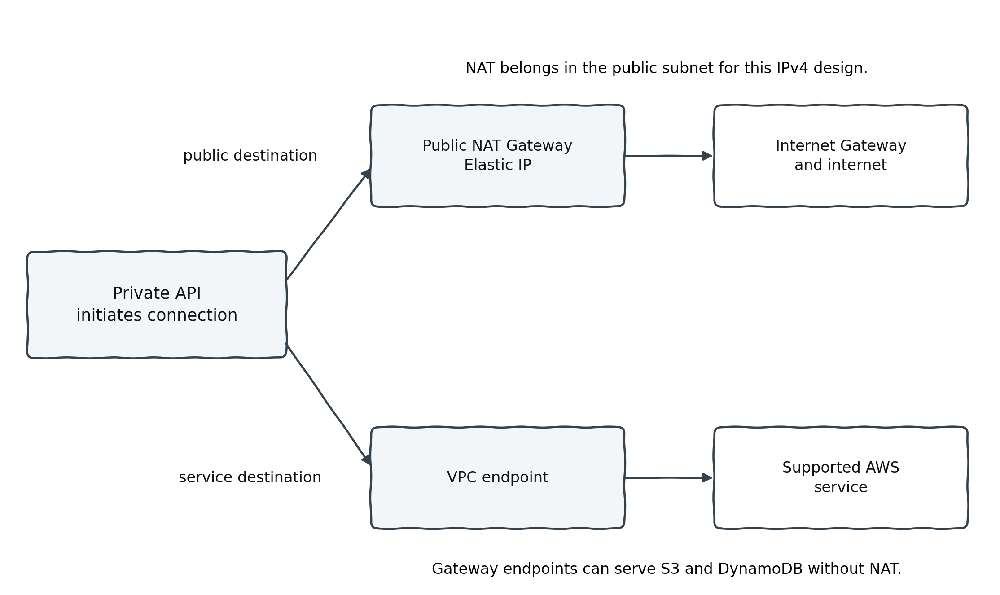

| Choice | Main role |
|---|---|
| Security group | Stateful allow rules for associated resources |
| Network ACL | Stateless ordered subnet allow and deny rules |
| IAM | Permission to perform AWS API actions |
| Application authorization | Permission for business resources and tenants |

Allow the required path between the load balancer, API, and database. A working network connection does not prove the caller has application permission.

## OSI layers and a real HTTP request

The **OSI Model** describes seven network layers. **HTTP is one application-layer protocol**, not seven layers of its own. The model separates what a request means from how data travels and where it goes.

| Layer | Name | Simple role |
|---|---|---|
| 7 | Application | Protocol meaning, such as HTTP requests and DNS queries |
| 6 | Presentation | Data representation, encoding, encryption, compression |
| 5 | Session | Organizing communication sessions |
| 4 | Transport | TCP or UDP communication and ports |
| 3 | Network | IP addressing and routing between networks |
| 2 | Data Link | Frames on a local link, such as Ethernet |
| 1 | Physical | Bits carried by electrical, optical, or radio signals |

This is a learning model. Real internet protocols follow TCP/IP; functions such as TLS encryption and session handling are not always separate literal layers in an implementation.

For https://api.example.com/orders/123, HTTP identifies the requested order, the connection commonly uses port 443, and IP routing chooses a network destination. A service that understands HTTP can route by /orders. A transport-level service handles connection information instead.

## How the layers help explain AWS

| Service | Relevant level | Example decision |
|---|---|---|
| ALB | L7 application | Route /orders and /payments to different targets |
| NLB | L4 transport | Distribute TCP or UDP flows |
| API Gateway | L7 application | API routing, authorization integrations, throttling |
| Security Group | L3 and L4 information | Allow TCP 443 from an approved source |
| Network ACL | L3 and L4 information | Allow or deny subnet traffic by IP and port rules |
| WAF | L7 HTTP information | Inspect request paths, headers, and supported body content |
| VPC route table | L3 destination routing | Send a destination IP range to a gateway |

Opening port 443 in a Security Group allows a network path. It does not mean every HTTP request will pass WAF or application authorization.

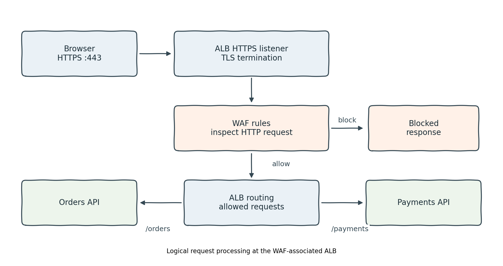

In this example the **ALB terminates TLS** from the client so the HTTP request can be inspected and routed. WAF blocks matching requests. Allowed traffic follows ALB rules to the appropriate service. The ALB-to-target connection can use HTTP or HTTPS, depending on configuration. Calling ALB a Layer 7 service describes its HTTP-aware decisions; it still relies on lower network layers.

Further reading [S168] [S169] [S170] [S171]

## ALB API Gateway and compute

**ALB** routes application HTTP traffic to targets. **API Gateway** provides an API entry layer with features such as authorization integrations and throttling, depending on API type. Use both only when the required behavior justifies both.

| Service | Simple meaning |
|---|---|
| EC2 | Virtual machines |
| ECS | AWS container orchestration |
| EKS | Managed Kubernetes control plane |
| Fargate | Managed compute for supported ECS tasks or EKS Pods |
| Lambda | Event-driven function execution |

**Fargate** is compute, not another name for ECS or Kubernetes. **EKS Auto Mode** adds AWS-managed infrastructure capabilities. Choose based on workload needs, team experience, and cost.

## Data messaging and identity

| Service | Useful purpose |
|---|---|
| S3 | Objects such as receipts photos and exports |
| EBS | Block volumes for supported EC2 workloads |
| EFS | Shared file storage |
| RDS PostgreSQL | Managed relational database |
| ElastiCache | Managed cache infrastructure |
| SQS | Durable queued work |
| SNS | Publish to independent subscribers |

A conventional **RDS Multi-AZ DB instance** uses a standby for failover. **Read replicas** scale suitable reads and can lag. Multi-AZ DB clusters have a different readable-standby arrangement, so state which deployment you mean.

For **SQS**, receiving a message does not delete it. During **visibility timeout**, other consumers normally cannot receive it. Finish the work and delete the message; handle retries and dead-letter recovery.

Use **IAM roles** for workload credentials and grant only required actions and resources. **CloudWatch** supports operational metrics, logs, and alarms. **CloudTrail** records supported AWS account and API activity. Neither replaces business-level monitoring.

**Step Functions** coordinates workflows and can use services such as **DynamoDB**. Keep downstream side effects safe under the workflow's retry rules.

## AWS and GCP service map

**Google Cloud**, often called **GCP**, offers many of the same building blocks as AWS. Compare responsibilities, then check behavior and limits. These are useful comparisons, not promises of identical features.

| Need | AWS example | GCP comparison |
|---|---|---|
| Virtual machines | EC2 | Compute Engine |
| Managed Kubernetes | EKS | GKE |
| Managed container services | ECS on Fargate | Cloud Run for suitable workloads |
| Object storage | S3 | Cloud Storage |
| Managed PostgreSQL | RDS PostgreSQL | Cloud SQL for PostgreSQL |
| Managed cache | ElastiCache | Memorystore |
| HTTP load balancing | ALB | Application Load Balancer |
| DNS | Route 53 | Cloud DNS |

| Need | AWS example | GCP comparison |
|---|---|---|
| Event distribution | SNS with SQS subscriptions | Pub/Sub topics and subscriptions |
| Controlled HTTP task delivery | SQS plus a worker design | Cloud Tasks |
| Workflow orchestration | Step Functions | Workflows |
| Secrets | Secrets Manager | Secret Manager |
| Metrics and logs | CloudWatch | Cloud Monitoring and Cloud Logging |
| Audit activity | CloudTrail | Cloud Audit Logs |
| Web filtering | WAF | Cloud Armor for supported endpoints |
| Container images | ECR | Artifact Registry |

Do not translate every product name one for one. For example, Firestore is a document database; DynamoDB supports key-value and document access with different modeling rules. BigQuery is for analytics, not a replacement for an order transaction database. Pick the data model and workload before the service.

## Differences that matter in an interview

**Network scope.** An AWS VPC is regional and its subnets belong to Availability Zones. A standard GCP VPC network is global and its subnets are regional, usable across zones in that region. Global network scope does not make every application resource multi-region. Routes, firewall rules, endpoints, and workload placement still control reachability.

**Container operations.** EKS and GKE both expose Kubernetes concepts. GKE Standard and Autopilot divide operational responsibility differently. Cloud Run services run containers with managed request routing and scaling; ECS on Fargate combines ECS orchestration with managed compute. They overlap for some APIs, but request handling, background work, networking, and scaling controls differ. Check the workload rather than calling them identical.

**Identity.** AWS commonly separates environments using accounts and IAM roles. GCP uses organizations, folders, projects, and IAM policies, with service accounts for workload identities. Account and project are useful isolation comparisons, not identical resource models. Prefer short-lived workload credentials and least privilege on either cloud.

**Messages.** With SNS fanout, you can deliver one event to several SQS queues. Each queue has its own workers and retry behavior. With GCP Pub/Sub, independent subscriptions provide independent delivery paths; subscribers sharing one subscription share its work. Cloud Tasks instead targets a specific endpoint with scheduling and delivery-rate controls. All consumers still need failure and duplicate handling appropriate to the chosen service.

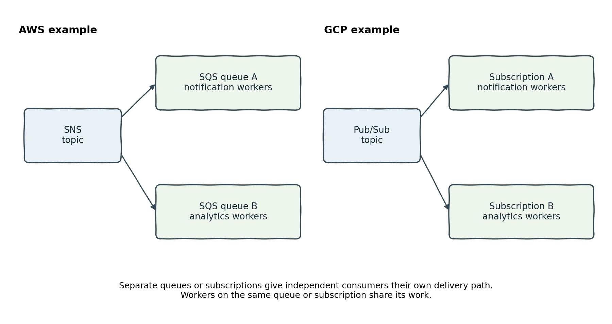

SNS does not require SQS internally for every subscription: it also supports other endpoint types. The diagram shows one common durable fanout design, not the only SNS design. Pub/Sub is also not a drop-in Kafka replacement; partition, replay, ordering, and consumer behavior need separate review.

## Choosing a cloud for the same application

For a Spring Boot ordering API, one design could use ALB, ECS on Fargate, RDS PostgreSQL, and S3. A GCP alternative could use Cloud Run, Cloud SQL for PostgreSQL, and Cloud Storage, with load balancing added when its features are needed. A team already using Kubernetes could compare EKS and GKE instead.

Choose from the existing estate, team experience, required regions, managed service fit, security, recovery targets, and total cost. Include egress, networking, observability, backups, and engineering effort. Neither cloud is always cheaper or more reliable. Check current regional prices and quotas for a real estimate. Keep cross-cloud deployments only when the benefit justifies duplicated operational work.

Further reading [S172] [S173] [S174] [S175] [S176] [S177] [S178]

## AI usage hint

Use AI to draft service mappings or configuration. Check official documentation, permissions, regional availability, and cost before using the result.

## Interview questions and answers

**Q181 How do a Region and an Availability Zone differ?**

A Region is a geographic deployment area. It contains separate Availability Zones. Using several zones can reduce the effect of losing one zone.

**Q182 What makes a subnet public or private?**

In a conventional IPv4 design, a public subnet has a direct route to an Internet Gateway. A private subnet does not. A route alone does not give every resource public access.

**Q183 What does a NAT Gateway do?**

It lets appropriately routed private IPv4 resources start outbound internet connections. It is not the customer-facing entry point for your API. A load balancer or gateway serves that role.

**Q184 How do security groups and network ACLs differ?**

Security groups use stateful allow rules for associated resources. Network ACLs use ordered allow and deny rules at the subnet boundary and are stateless.

**Q185 How do ALB and API Gateway differ?**

ALB routes application traffic to targets. API Gateway provides API entry and management features that depend on API type. Use the features your design needs; both can be used together.

**Q186 How do managed container options compare across AWS and GCP?**

EKS and GKE provide managed Kubernetes. ECS orchestrates containers and can use Fargate compute. Cloud Run services provide managed container execution and request routing. Compare workload needs, operational control, and scaling behavior rather than assuming exact equivalents.

**Q187 How do S3 EBS and EFS differ?**

S3 stores objects. EBS provides block volumes for supported EC2 workloads. EFS provides shared file storage. Choose from the application's access and sharing needs.

**Q188 How do RDS Multi AZ and read replicas differ?**

A conventional Multi-AZ DB instance uses a standby for failover. Read replicas support read scaling and can lag. RDS Multi-AZ DB clusters have different readable-standby behavior, so name the deployment type.

**Q189 Why use an IAM role instead of a stored AWS access key?**

A role can provide temporary credentials to a workload. Give it only the actions and resources it needs. Network access and application authorization remain separate checks.

**Q190 How do SNS SQS and GCP Pub Sub compare?**

SQS queues work. SNS can fan events out to independent SQS queues or other endpoints. GCP Pub/Sub uses topics and subscriptions; separate subscriptions provide independent delivery paths. Cloud Tasks targets explicit task delivery. These services differ in control and delivery behavior.

Further reading [S89] [S91] [S94] [S95] [S98] [S102] [S106]

# AI system design

**RAG** means retrieval-augmented generation. It retrieves relevant source material and passes it to the model as context for an answer.

For example, an assistant can retrieve the tenant's current refund policy before answering a staff question. For live stock or payment status, use a trusted API instead of an old document copy.

## The main flow

Store trusted documents with tenant, permission, version, and update metadata. Split them into useful chunks and build an index. At question time, derive trusted access filters, retrieve relevant evidence, then ask the model to answer from it.

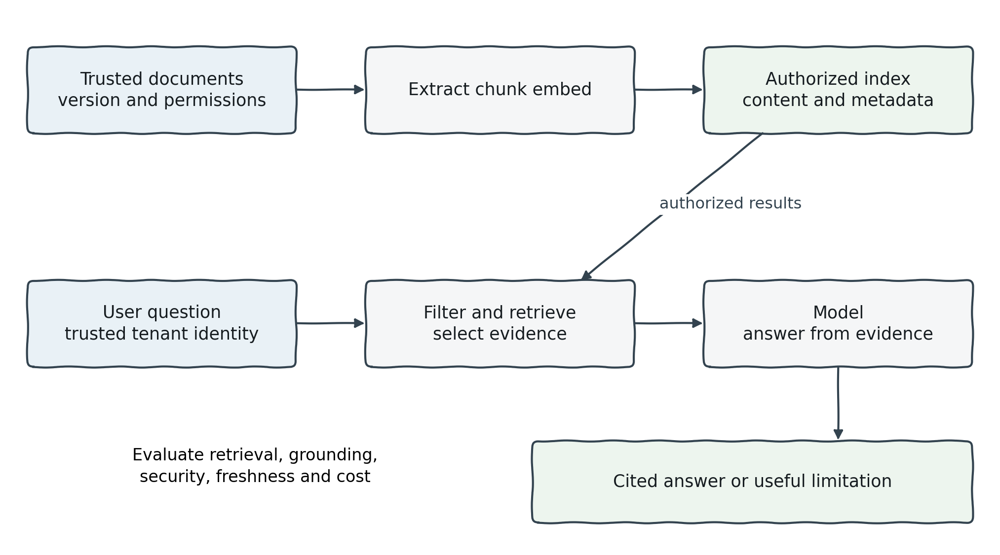

**Embeddings** support similarity search. Keyword search and reranking can also help. Keep only the evidence needed for a useful answer. Update or remove indexed material when the source changes.

## Security and evaluation

Apply **authorization before retrieval results reach the model**. A final answer filter cannot undo exposure of another tenant's data.

Treat instructions inside retrieved content as untrusted data. **Prompt injection** can try to make the assistant ignore rules or misuse tools. Limit tool permissions and validate operations in backend code.

| Check | What to test |
|---|---|
| Retrieval | Finds relevant authorized sources |
| Answer quality | Uses evidence and handles missing answers |
| Freshness | Uses current versions and removes revoked content |
| Security | Blocks cross-tenant access and unsafe tool actions |
| Operations | Meets latency cost and failure targets |

**Streaming** can show the first output sooner while total work still takes longer. Measure both. Include retrieval, model usage, indexing, retries, and support in cost estimates.

## Interview questions and answers

**Q191 What is RAG?**

Retrieval-augmented generation retrieves relevant source material and gives it to the model as context. It helps answers use external information without retraining the model for each update.

**Q192 When should you use a live API instead of document retrieval?**

Use a trusted live API for current structured facts such as payment status or stock. A document index may be stale even if retrieval works correctly.

**Q193 Does RAG guarantee a correct answer?**

No. The source must be current, retrieval must find the right evidence, and the answer must use it correctly. Return a useful limitation when evidence is missing.

**Q194 Where should tenant authorization happen in a RAG flow?**

Before content reaches the model, logs, or user. Use trusted tenant and permission filters during retrieval. Filtering only the final answer is too late.

Further reading [S125] [S126] [S143]

# Agentic AI for coding

**Agentic coding** gives an AI a goal, relevant project context, tools, and a way to check its work. The agent can inspect code, make a change, run checks, and use the results to decide what to do next. The engineer still owns the result.

## Know the parts

| Part | Simple meaning | Example |
|---|---|---|
| Model | Reasoning engine | Claude |
| Agent or harness | Manages context, tools, and the work loop | Cursor Agent or Claude Code |
| Context | Relevant facts for this task | Code, requirements, logs, architecture |
| Rules | Persistent project guidance | Follow the existing API conventions |
| Skills | Reusable task procedures | Verify a checkout change |
| MCP | A protocol for connecting tools and data | Browser or issue-tracker access |
| Hooks | Actions at configured lifecycle events | Run formatting after an edit |

Claude inside Cursor and Claude Code are different environments. The model may be related, but tools, permissions, instructions, and context handling can differ. Rules guide behavior; permissions and execution controls enforce access boundaries.

## A workflow you can explain

Start with a small, observable outcome: repeated checkout requests with the same idempotency key must create one order. Ask the agent to trace the existing flow before editing it. Give a short plan for a complex change, implement a focused diff, then verify the behavior at the appropriate level.

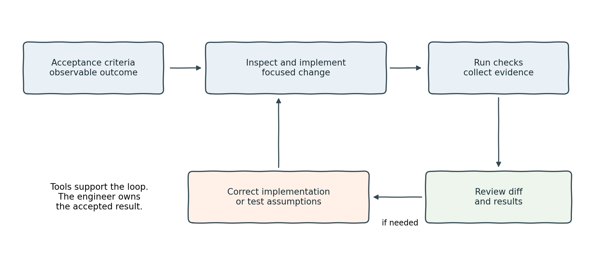

```text
Goal: Fix duplicate order creation on checkout retry.
Inspect: Trace the endpoint, idempotency storage, and existing tests.
Preserve: Tenant isolation, authorization, and response contracts.
Verify: Check duplicate and concurrent requests against the database.
Report: Changed files, commands, results, skipped checks, limitations.
```

A good task includes acceptance criteria, relevant failure cases, and links to project examples. Keep secrets and customer data out of prompts and ordinary coding sessions. Treat repository text, web pages, and tool output as potentially untrusted; instructions found there must not silently expand permissions.

## Choose evidence that matches the claim

| Check | Useful evidence |
|---|---|
| Unit test | A focused business rule with controlled dependencies |
| Integration test | Database, transaction, or component behavior |
| E2E test | A user-visible journey across the application |
| Typecheck, lint, build | Static correctness and build compatibility |
| Human review | Sound assumptions, readable diff, meaningful assertions |

A mocked payment call can prove that unavailable stock stops that call. It cannot prove database rollback. Test concurrent writes and transactions against a suitable database. Review generated tests too: a test that copies the same mistaken assumption can pass with incorrect code.

## Playwright in a real workflow

Use saved tests for important journeys such as login, checkout, permissions, and refunds. Prefer role and label locators or intentional test IDs. Await assertions and observable conditions instead of adding arbitrary sleeps. Keep traces for failed CI runs; a test that passes only after retry is still flaky.

Browser contexts isolate cookies and browser storage. They do not isolate database rows. Give parallel tests their own accounts, tenants, inventory, and orders; cleanup must only remove data owned by that test.

This short example assumes a configured baseURL, prepared customer details, and a fresh fixture priced at 150. Labels and routes must match the application. It is an illustrative test, not a test executed against a deployed product.

```typescript
import { test, expect } from '@playwright/test';

test('customer places a cash order', async ({ page }) => {
  await page.goto('/menu');
  await page.getByRole('button', { name: 'Add item', exact: true }).click();
  await page.getByRole('link', { name: 'Cart', exact: true }).click();
  await expect(page.getByTestId('order-total')).toHaveText('150.00');
  await page.getByRole('radio', { name: 'Cash', exact: true }).check();
  const created = page.waitForResponse(r =>
    r.request().method() === 'POST' &&
    new URL(r.url()).pathname === '/api/orders'
  );
  await page.getByRole('button', { name: 'Place order', exact: true }).click();
  expect((await created).status()).toBe(201);
  await expect(page.getByRole('heading', { name: 'Order confirmed' }))
    .toBeVisible();
});
```

Run a saved test with npx playwright test tests/e2e/checkout.spec.ts. For full integration coverage, use the real frontend, backend, and test database; identify provider stubs or sandbox integrations explicitly. A 201 plus confirmation covers this journey, not every stock, payment, or retry rule.

## MCP supplies tools and skills supply procedures

Playwright MCP lets an agent inspect and interact with a browser. A saved Playwright test instead supplies repeatable assertions for CI. Exploring successfully with browser tools is useful evidence, but is not the same as saving and running a regression test. MCP is optional; an agent can also run CLI tools.

For example, a Cursor project configuration at .cursor/mcp.json can contain:

```json
{
  "mcpServers": {
    "playwright": {
      "command": "npx",
      "args": ["-y", "@playwright/mcp@latest", "--isolated"]
    }
  }
}
```

This setup uses latest for exploration; pin a tested package version in a shared team setup. The isolated browser profile does not create database isolation or make tool access harmless. Review trusted servers and give only the permissions needed.

A Claude Code stdio setup can use:

```bash
claude mcp add --transport stdio playwright -- \
    npx -y @playwright/mcp@latest --isolated
```

A project skill could live at .claude/skills/verify-checkout/SKILL.md. Cursor has its own .cursor/skills/ location and documents compatible skill locations. Check the installed tool version before copying configuration.

```markdown
---
name: verify-checkout
description: Verify checkout changes with backend and browser checks.
---
Read acceptance criteria and repository test commands.
Prepare independent test data and trace the affected flow.
Run focused unit and database integration checks.
Investigate the user journey with browser tools when useful.
Save or update regression assertions and run the saved test.
Report actual results, skipped checks, and remaining limitations.
Never describe an unexecuted check as passed.
```

Invoke the example as /verify-checkout. A skill packages instructions and can include scripts or templates; it does not grant tool permissions. Keep project rules short and current: .cursor/rules/*.mdc for Cursor and CLAUDE.md for Claude Code are common entry points.

## Interview traps and team practice

| Weak claim | Better explanation |
|---|---|
| The agent clicked through it, so it is tested | Separate exploration from repeatable assertions |
| All checks passed | Name what ran, what was mocked, and what was skipped |
| More E2E tests always help | Choose the smallest level that proves the behavior |
| Rules prevent unsafe actions | Use permissions, isolation, CI, and review as controls |
| More agents are always faster | Include coordination, conflicting edits, review, and cost |

Use branches or worktrees for independent edits. Measure accepted changes, rework, defects, review effort, flakiness, and cost, rather than lines generated. Restrict production access. The final report should make remaining uncertainty visible.

## Interview questions and answers

**Q195 How do MCP and skills differ in an agentic coding workflow?**

MCP connects the agent to tools or data. A skill describes a reusable procedure for a task. Neither replaces access controls, and MCP is optional when built-in tools or CLIs already provide the needed capability.

**Q196 What evidence should you ask for before accepting an AI coding change?**

Review the diff and require appropriate executable checks. Ask for commands, results, mocked dependencies, skipped checks, and limitations. A browser demonstration or passing generated test alone does not prove the full business behavior.

Further reading [S179] [S180] [S181] [S182] [S183] [S184] [S185] [S186]

# Design documents postmortems and leadership

## Technical design documents

A **technical design document** helps the team review a change before implementation. Explain the problem, intended behavior, main flows, alternatives, failure handling, rollout, and owners. A small change needs a short note; a payment workflow needs more evidence.

Use the companion **design_document_template.md**. Keep sections that help the decision and remove those that do not.

## A short worked design

This is a practice scenario for the ordering system, not a claim about an employer's private system.

**Problem:** Sending an email during checkout makes the response depend on the provider. A crash can also leave an order without a notification.

**Goal:** Save notification intent with order confirmation, return a useful order response, and recover delivery after a restart.

**Design:** Write an Outbox event in the order transaction. Publish it to a durable queue. A worker creates or resumes the notification and calls the provider with a stable supported idempotency key.

**Tradeoff:** More worker and duplicate-handling work, in return for recovery after failure. A simpler in-memory listener may be enough only when best-effort delivery is acceptable.

**Validation:** Check normal delivery, duplicate events, provider timeout, and a worker crash after publish or send. Monitor delivery age and failures. If the provider has no idempotency support, record the remaining duplicate window.

**Rollout:** Add compatible schema and events first. Enable one dispatch path for a small group, observe results, then expand. Keep pending work during a rollback.

An **ADR**, or architecture decision record, captures one important choice: context, decision, alternatives, consequences, status, and owner. Link it to the wider design document.

## Postmortems

A **postmortem** explains user impact, the timeline, contributing causes, and what will change. **Blameless** means examining system conditions instead of stopping at personal blame. Actions still need owners and evidence of completion.

The example below is fictional. A promotion caused extra API replicas while a new report held database connections during remote waits. Potential connection demand grew beyond the API budget.

| Relative time | Event |
|---|---|
| Start | Promotion traffic rises and pool waiting grows |
| After 2 minutes | Error alert starts incident coordination |
| After 5 minutes | Traces show pool waits and long report transactions |
| After 7 minutes | Team pauses nonessential reports |
| After 12 minutes | Queue drains and order checks confirm recovery |

**Impact:** 240 of 1200 eligible order attempts failed before order creation, a 20 percent attempt failure rate. These are attempts, not necessarily 240 different customers.

**Contributing causes:** Too many possible connections across replicas, remote waiting inside a database transaction, and a load test that missed the slow-dependency case. The promotion was the trigger, not a complete cause.

| Action | Owner role | Evidence |
|---|---|---|
| Remove remote waits from the transaction | Reports lead | Trace and test show short connection holding |
| Enforce a total connection budget | Platform engineer | Check covers maximum replica and worker counts |
| Add slow-dependency and spike tests | Quality owner | Results include pool waiting latency and recovery |

Use **postmortem_template.md** to record dates, owners, evidence, and unresolved questions. Recovery is confirmed by restored user operations, not only by a successful restart.

## Leadership answers

Use your own experience and explain the options, **cost**, **team ownership**, and results.

## AI usage hint

Use AI to improve structure or find missing failure cases. Keep ownership of decisions and verify every incident fact, number, and claimed result.

## Interview questions and answers

**Q197 What belongs in a technical design document?**

Cover the problem, constraints, proposal, data and API changes, failures, security, capacity, rollout, validation, and owners. Match the length to the decision.

**Q198 How does an ADR differ from a design document?**

An ADR records one decision, its reasons, and consequences. A design document explains the wider change. Link them when useful.

**Q199 What makes a postmortem useful?**

Connect impact, timeline, evidence, causes, and owned actions. Explain why the system allowed the failure and how you will verify the fix.

**Q200 How should an engineering leader explain an architecture decision?**

Explain the business need and constraints, compare options, describe the chosen tradeoff, and name the owner. State what evidence would make you reconsider.

Further reading [S127] [S128] [S129]
